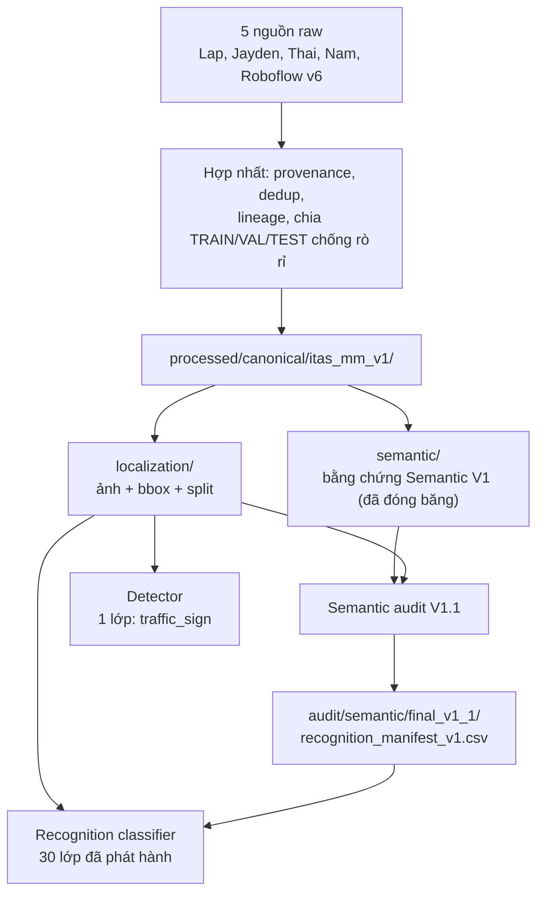

# ITAS-MM - Bộ dữ liệu biển báo giao thông Việt Nam (đã hợp nhất)

> Cập nhật: 2026-10-07. README này là điểm vào duy nhất. Nếu bạn chỉ có 3-5 phút, đọc mục 1 đến mục 4.

## 1. Tôi cần train cái gì, lấy dữ liệu ở đâu?

| Việc cần làm | Ảnh (pixel) lấy ở | Box / nhãn lấy ở |
|---|---|---|
| **Detector** (tìm biển báo, 1 lớp `traffic_sign`) | `processed\canonical\itas_mm_v1\localization\` | cùng thư mục đó (`labels\`, `data.yaml`) |
| **Recognition classifier** (biển báo này là loại gì, 30 lớp) | `processed\canonical\itas_mm_v1\localization\` (cắt crop từ ảnh) | `audit\semantic\final_v1_1\recognition_manifest_v1.csv` |
| Ánh xạ `class_index` <-> mã biển QCVN | - | `audit\semantic\final_v1_1\recognition_classes_v1.csv` |
| Đầu tốc độ cho P.127 (tùy chọn) | như Recognition | cột `speed_kmh` + `speed_training_eligible` trong manifest |

Hai câu cần nhớ:

- **PIXEL ẢNH:** `processed\canonical\itas_mm_v1\localization\`
- **QUYẾT ĐỊNH NHÃN CUỐI CỦA RECOGNITION:** `audit\semantic\final_v1_1\`

5 bộ dữ liệu nguồn **không** có nghĩa là train 5 model. Cả 5 đã được hợp nhất thành **một** bộ canonical, rồi dùng cho **hai** nhiệm vụ (detector và recognition).

## 2. Sơ đồ tổng quan



Bản chữ (nếu trình xem Markdown không vẽ được Mermaid):

```text
5 nguồn raw
   |  hợp nhất, provenance, dedup, lineage, split chống rò rỉ
   v
processed/canonical/itas_mm_v1/
   |-- localization/  : ảnh + bbox + split        -> trả lời "biển báo nằm ở đâu?"
   |-- semantic/      : bằng chứng Semantic V1    -> KHÔNG phải nhãn train cuối
                              |
                       semantic audit V1.1
                              v
              audit/semantic/final_v1_1/        : quyết định nhãn cuối

Detector       = localization/ (1 lớp traffic_sign)
Recognition    = ảnh từ localization/ + hộp/nhãn từ final_v1_1/recognition_manifest_v1.csv
```

## 3. Cấu trúc thư mục

```text
ITAS-MM/
├─ raw/                              # nguồn gốc bất biến, KHÔNG sửa
│  ├─ kaggle/<owner>/<slug>/vN/      # archive.zip + dataset/
│  └─ roboflow/.../v6/               # Roboflow v6 COCO
├─ processed/
│  └─ canonical/
│     └─ itas_mm_v1/
│        ├─ DATASET_CARD.md
│        ├─ localization/            # pixel canonical + nhãn detector
│        │  ├─ data.yaml             # nc: 1, names: [traffic_sign]
│        │  ├─ images/{train,val,test}/
│        │  ├─ labels/{train,val,test}/   # YOLO txt, class 0
│        │  ├─ samples.csv           # 15,603 ảnh (1 dòng / ảnh)
│        │  └─ boxes.csv             # 30,558 canonical box
│        └─ semantic/                # bằng chứng Semantic V1 (đóng băng, giữ lại)
├─ audit/
│  ├─ DATASET_PIPELINE_STATE.md      # nhật ký pipeline
│  ├─ README.md                      # kết quả quét cấu trúc ban đầu
│  └─ semantic/
│     ├─ ... (các file audit lịch sử, đừng xóa)
│     └─ final_v1_1/                 # BÀN GIAO CUỐI cho recognition
│        ├─ recognition_manifest_v1.csv
│        ├─ recognition_classes_v1.csv
│        ├─ semantic_labels_v1_1.csv
│        ├─ FINAL_SEMANTIC_AUDIT.md
│        ├─ FINAL_MANIFEST.json
│        └─ rebuild_semantic_v1_1.py
├─ tools/audit_datasets.py           # quét cấu trúc raw
├─ download-manifest.csv, sources.json
└─ README.md                         # file này
```

## 4. Hai thư mục canonical: `localization/` và `semantic/`

Đây là chỗ dễ nhầm nhất.

### `localization/` - bộ dữ liệu vật lý canonical

- Ảnh canonical (đã dedup), nhãn YOLO một lớp, `samples.csv`, `boxes.csv`, và chia TRAIN / VAL / TEST.
- Trả lời: **"Biển báo nằm ở đâu?"**. Detector chỉ có **một** lớp: `traffic_sign`.
- Ảnh dùng cho **cả detector và recognition** đều nằm ở đây.
- Chia split theo nhóm lineage (chống rò rỉ): ảnh TRAIN 10,952 / VAL 2,325 / TEST 2,326 (tổng 15,603); box TRAIN 20,923 / VAL 4,747 / TEST 4,888 (tổng 30,558). Không tự chia lại.

### `semantic/` - lớp bằng chứng Semantic V1 (cũ)

Gồm `source_annotation_semantic_v1.csv`, `semantic_overlay_v1.csv`, `crop_manifest_v1.csv`, `unresolved_queue_v1.csv`, `semantic_manifest_v1.json`, `semantic_coverage_v1.md`.

> **CẢNH BÁO:** các file này **KHÔNG** phải nhãn train cuối của Recognition V1.1. Chúng là bằng chứng/provenance đã đóng băng và là đầu vào cho bước semantic audit có thể tái lập. **Giữ nguyên, không xóa, và không train trực tiếp từ `semantic_overlay_v1.csv`.** Khuyến nghị Semantic V1 cũ đã được Semantic V1.1 thay thế.

### `audit/semantic/final_v1_1/` - bản phát hành semantic cuối

| File | Vai trò |
|---|---|
| `recognition_manifest_v1.csv` | **Đầu vào trực tiếp** cho recognition (10,003 dòng) |
| `recognition_classes_v1.csv` | Ánh xạ `class_index` <-> `canonical_sign_code` (30 lớp) |
| `semantic_labels_v1_1.csv` | Disposition cuối của cả 30,558 box (released / masked / thiếu hỗ trợ...) |
| `FINAL_SEMANTIC_AUDIT.md` | Báo cáo có thẩm quyền, giải thích toàn bộ bản phát hành |
| `FINAL_MANIFEST.json` | Metadata máy đọc: số liệu, ngưỡng, hash, trạng thái |
| `rebuild_semantic_v1_1.py` | Script tái dựng và kiểm chứng (`--verify`) |

## 5. How to train

### A. Localization detector (1 lớp)

Dùng `D:\DSP391m\datasets\ITAS-MM\processed\canonical\itas_mm_v1\localization\`:

```text
data.yaml          # nc: 1, names: [traffic_sign]
images\train  images\val  images\test
labels\train  labels\val  labels\test      # YOLO: class cx cy w h (chuẩn hóa)
```

- Detector YOLO một lớp: `class = traffic_sign` (id 0).
- **TRAIN** để train, **VAL** để chọn model/tuning, **TEST** chỉ đánh giá cuối cùng.
- `data.yaml` dùng `path: .` (tương đối với thư mục chứa nó). Nếu framework không hiểu, thay bằng đường dẫn tuyệt đối tới `localization\`.
- Detector đã sẵn sàng train và **không phụ thuộc** vào bản phát hành semantic.

### B. Recognition classifier (30 lớp)

- Manifest chính: `audit\semantic\final_v1_1\recognition_manifest_v1.csv`
- Bản đồ lớp: `audit\semantic\final_v1_1\recognition_classes_v1.csv`
- Thư mục gốc ảnh: `D:\DSP391m\datasets\ITAS-MM\processed\canonical\itas_mm_v1\localization`

Cột chính của manifest: `canonical_box_id`, `image_path` (tương đối so với `localization\`, ví dụ `images/train/<sha>.jpg`), `bbox_xyxy`, `split`, `class_index`, `canonical_sign_code`, `speed_kmh`, `speed_training_eligible`, `semantic_training_eligible`, `short_side_px`, `evidence_tier`, `independent_support_unit_id`.

**Mã hóa bbox (đã kiểm tra trên dữ liệu thật):** `bbox_xyxy` là chuỗi dạng `"[51.0, 21.0, 445.0, 640.0]"` = `[x1, y1, x2, y2]` theo **pixel tuyệt đối** của ảnh canonical (không chuẩn hóa). Khác với nhãn YOLO ở `labels\` là dạng chuẩn hóa `cx cy w h`.

`bbox_xyxy` là tọa độ **liên tục** (khoảng 88% dòng có phần thập phân). Vì `right`/`bottom` của `PIL.Image.crop` là **exclusive**, nên dùng `floor` cho `x1, y1` và `ceil` cho `x2, y2` (như trong code mẫu dưới đây): cách này tạo ra crop số nguyên **nhỏ nhất bao trọn** bbox liên tục. Đây là quy ước khuyến nghị cho DataLoader; đừng cộng thêm `+1` ngoài quy ước đó.

> **Đọc kỹ số dòng:** `recognition_manifest_v1.csv` có **10,003 dòng tổng cộng**:
>
> | split | số dòng | dùng để |
> |---|---:|---|
> | TRAIN | 5,673 | train |
> | VAL | 1,272 | validation / chọn model |
> | TEST | 3,058 | **chỉ** đánh giá cuối |
>
> TRAIN + VAL (development) = **6,945 dòng**. **10,003 KHÔNG phải kích thước tập train.** TEST tuyệt đối không dùng để train hay chọn model.

Logic DataLoader:

1. đọc một dòng từ `recognition_manifest_v1.csv`;
2. ảnh = `localization_root / image_path`;
3. mở ảnh;
4. cắt crop theo `bbox_xyxy`;
5. target = `class_index`;
6. dòng `TRAIN` để train, dòng `VAL` để chọn/tune model, dòng `TEST` chỉ để đánh giá cuối.

```python
import json
import math
from pathlib import Path
import pandas as pd
from PIL import Image

root = Path(r"D:\DSP391m\datasets\ITAS-MM")
localization_root = root / r"processed\canonical\itas_mm_v1\localization"
manifest = pd.read_csv(root / r"audit\semantic\final_v1_1\recognition_manifest_v1.csv")

train = manifest[manifest.split == "TRAIN"]   # val: "VAL", đánh giá cuối: "TEST"

for row in train.itertuples():
    image = Image.open(localization_root / row.image_path).convert("RGB")
    x1, y1, x2, y2 = json.loads(row.bbox_xyxy)           # pixel xyxy (liên tục)
    left   = max(0, math.floor(x1))
    top    = max(0, math.floor(y1))
    right  = min(image.width,  math.ceil(x2))
    bottom = min(image.height, math.ceil(y2))
    crop = image.crop((left, top, right, bottom))
    label = row.class_index                               # 0..29
    # resize/augment tại đây, rồi đưa vào model
```

Ghi chú: mọi dòng TRAIN/VAL trong manifest đã thỏa `semantic_training_eligible = TRUE` (cạnh ngắn >= 32 px). Dòng TEST có `semantic_training_eligible = FALSE` (chỉ để đánh giá); nên báo cáo kết quả TEST theo `short_side_px` (>= 32 và < 32).

#### Padding quanh bbox

`bbox_xyxy` trong manifest là bbox canonical **sát biển** (tight). Nếu dùng thêm context/padding cho Recognition, hãy coi padding là **siêu tham số của model**, giữ chính sách cố định và xác định (deterministic), và chỉ chọn bằng **VAL**, không bao giờ dùng TEST.

#### Augmentation safety for Recognition

Nhiều lớp biển nhạy theo hướng (ví dụ `P.123a` cấm rẽ trái và `P.123b` cấm rẽ phải), nên biến đổi hình học có thể đổi nghĩa biển trong khi nhãn vẫn giữ nguyên. Quy tắc dưới đây đặc biệt quan trọng cho **Recognition classifier**; augmentation của detector một lớp `traffic_sign` có ngữ nghĩa khác.

- **Horizontal flip: TẮT mặc định.** Chỉ được bật nếu có chính sách remap lớp tường minh và đã được kiểm chứng.
- **Vertical flip: TẮT.**
- **Không** xoay 90 hoặc 180 độ.
- Biến đổi hình học (xoay nhẹ, scale, dịch) chỉ ở mức **nhẹ**.
- Tránh đổi màu mạnh (hue/color jitter), vì màu của biển (đỏ, xanh, vàng) mang nghĩa.
- Random crop / random erasing không được che mất phần nội dung phân biệt của biển.

#### Đánh giá và mất cân bằng lớp

Recognition V1 **mất cân bằng lớp**: `P.127` có 1,070 box TRAIN, trong khi lớp ít nhất là `R.122` (65 box TRAIN); về VAL, một số lớp chỉ có 12-13 box (`W.203c`, `W.210`, `P.137`), nên chỉ số theo lớp ở VAL dao động mạnh.

**Không chỉ báo overall accuracy.** Tối thiểu báo:

- Top-1 Accuracy
- Macro F1
- Precision / Recall / F1 theo từng lớp (kèm số mẫu hỗ trợ)
- Confusion Matrix

Có thể thử class-weighted loss hoặc balanced sampler, nhưng mọi lựa chọn phải dựa trên **TRAIN/VAL**. TEST chỉ dùng để đánh giá cuối.

### C. Đầu tốc độ (tùy chọn, chỉ cho P.127)

`speed_kmh` là một **thuộc tính/đầu riêng** của biển P.127, **không** phải lớp detector. **Không** tạo lớp như `P.127_40`, `P.127_50`, `P.127_60`.

Quy tắc: chỉ tính speed loss khi

```text
canonical_sign_code == "P.127"  VÀ  speed_training_eligible == TRUE
```

còn lại thì mask/bỏ qua speed loss. Giá trị hợp lệ: 20, 30, 40, 50, 60, 70, 90, 100, 110, 120.

Hiện có 2,282 nhãn tốc độ đã phát hành (toàn bộ các box), trong đó 788 đủ điều kiện train (TRAIN 639, VAL 149; nằm trong manifest). Phần còn lại là box nhỏ hơn 32 px, thuộc TEST, hoặc không đủ điều kiện. Tốc độ của P.127 từ nguồn Thai vẫn là UNKNOWN trong V1.1.

## 6. Số liệu hiện tại (Semantic V1.1)

Trạng thái: `JOB_STATUS = COMPLETE`, `RELEASE_STATUS = SEMANTIC_V1_1_RELEASE_READY_WITH_LIMITATIONS`. Nguồn: `FINAL_MANIFEST.json`.

| Mục | Giá trị |
|---|---|
| Canonical box | 30,558 |
| Lớp Recognition V1 đã phát hành | 30 |
| Lớp thiếu hỗ trợ (không nằm trong V1) | 41 |
| Dòng trong `recognition_manifest_v1.csv` | 10,003 |
| TRAIN đủ điều kiện train | 5,673 (27.11% số box TRAIN) |
| VAL đủ điều kiện train | 1,272 (26.80% số box VAL) |
| TEST đã phát hành (chỉ đánh giá) | 3,058 |
| Phát hành TRAIN / VAL | 13,522 (64.63%) / 3,338 (70.32%) |
| Ngưỡng crop | cạnh ngắn >= 32 px |
| Ngưỡng hỗ trợ lớp | >= 50 box TRAIN, >= 10 box VAL, >= 8 support unit TRAIN, >= 2 support unit VAL |
| Kiểm TEST (mẫu đóng băng 200 dòng) | 78 đúng / 78 chấm được, 122 không chấm được; TEST_VALIDATION_PASS |

30 lớp đã phát hành: `DP.134 I.407a I.409 P.102 P.117 P.123a P.123b P.124a P.124d P.125 P.127 P.130 P.131a P.137 R.122 R.302a R.303 W.201a W.203c W.207 W.207b W.208 W.210 W.212 W.220 W.222a W.224 W.225 W.244 W.245a`.

> 30 lớp này **không** phải toàn bộ biển báo Việt Nam. Đây là tập con đủ bằng chứng và đủ hỗ trợ ở phiên bản V1. Danh sách 41 lớp thiếu hỗ trợ nằm trong `FINAL_MANIFEST.json` (`totals.insufficient_support_class_list`).

> **Class map V1.1 là baseline đã đóng băng.** Một số mã có quan hệ cha/subtype, ví dụ `W.207` và `W.207b`. Không merge, đổi tên hay remap chúng khi train baseline; nếu model nhầm giữa chúng thì báo confusion riêng để xử lý ở phiên bản ontology sau.

## 7. Không được làm

> - **KHÔNG** train recognition trực tiếp từ `semantic_overlay_v1.csv`.
> - **KHÔNG** dùng cả 30,558 box làm dữ liệu train classifier. Chỉ dùng các dòng trong `recognition_manifest_v1.csv`.
> - **KHÔNG** coi box bị mask/unresolved là mẫu âm. Mask nghĩa là **KHÔNG BIẾT / KHÔNG AN TOÀN cho supervised semantic training**, không phải "không phải biển báo".
> - **KHÔNG** tạo lớp `OTHER` từ dữ liệu bị mask.
> - **KHÔNG** đưa TEST vào train hay chọn model/tuning.
> - **KHÔNG** coi Thai v5 và Roboflow v6 là hai nguồn bằng chứng độc lập (cùng một họ provenance).
> - **KHÔNG** train 5 classifier sản xuất riêng cho 5 nguồn (chỉ làm ablation nghiên cứu nếu cần).
> - **KHÔNG** gán lại nhãn từ class ID thô của các nguồn raw.
> - **KHÔNG** dùng kết quả HOG/SVM cũ về tốc độ.
> - **KHÔNG** xóa các CSV audit cũ chỉ vì đã có `final_v1_1`.

## 8. Vì sao phải audit?

Các nguồn raw không tương thích hoàn toàn:

- ảnh trùng lặp (trong nguồn và giữa các nguồn);
- cùng một video xuất hiện ở nhiều phiên bản/nhiều split;
- tên lớp không nhất quán giữa các nguồn;
- lớp nguồn lẫn nhiều loại biển (mixed);
- nhãn sai ở các frame liền kề trong video;
- nhãn thô kiểu `khac` / `other`;
- mỗi nguồn gán nhãn cho các loại biển khác nhau.

Dùng thẳng raw sẽ gây **rò rỉ dữ liệu, nhiễu nhãn, đếm trùng, xung đột ngữ nghĩa và độ tin cậy giả**. Manifest cuối được tạo để ngăn các vấn đề này.

## 9. Giới hạn hiện tại

- Xác minh ngữ nghĩa do AI thực hiện, **không có** nhãn nào là `HUMAN_VERIFIED`.
- Blind V2 độc lập không khả dụng (`BLIND_V2_INDEPENDENT_REVIEW_NOT_AVAILABLE_IN_CURRENT_MISSION`).
- Độ phủ phát hành dưới mức mong muốn 75%.
- 41 lớp thiếu hỗ trợ nên không nằm trong V1.
- Nhiều box nhỏ hơn 32 px nên không dùng để train recognition V1.
- Trong kiểm TEST, 122/200 crop không chấm được; người đọc là một AI.
- Recognition hiện là **closed-set**: khi dùng thực tế cần xử lý **reject / unknown / OOD** (ví dụ ngưỡng tin cậy hiệu chuẩn trên VAL, mẫu không phải biển báo).
- `compound_relation` / `attached_to` thuộc POST_V1.
- Giấy phép/provenance vẫn ràng buộc việc phân phối lại (xem mục 11).

## 10. Quy trình gợi ý cho đồng đội

1. Train detector baseline từ `localization\`.
2. Train **một** classifier Recognition V1 hợp nhất từ `recognition_manifest_v1.csv`.
3. (Tùy chọn) Train đầu tốc độ P.127.
4. Đánh giá trên TEST đóng băng.
5. Ghi metric theo từng lớp và, nếu được, theo nguồn/provenance.
6. Thêm cơ chế reject/OOD.
7. Chỉ sau đó mới cân nhắc ablation theo nguồn hoặc mở rộng dữ liệu.

Mô hình chính là mô hình **hợp nhất** cho cả 5 nguồn. Train model riêng theo nguồn chỉ là nghiên cứu/ablation, không phải thiết kế sản xuất mặc định.

Chi tiết đầy đủ và hướng dẫn huấn luyện chính thức: `audit\semantic\final_v1_1\FINAL_SEMANTIC_AUDIT.md`.

## 11. Nguồn raw, giấy phép và provenance

Các nguồn raw được cô lập theo nhà cung cấp, chủ sở hữu, dự án và phiên bản đã ghim. Mỗi thư mục phiên bản giữ nguyên archive tải về và thư mục `dataset/` đã giải nén; ảnh và nhãn nguồn không bị đổi tên hay gán lại. Ảnh trong `localization\` là hardlink NTFS tới ảnh raw nên không sao chép byte ảnh.

| Nguồn | Phiên bản | Ảnh | Annotation | Định dạng | Giấy phép được báo cáo |
|---|---|---:|---:|---|---|
| Lap Nguyen (`lapnguyen`) | v2 | 10,157 | 19,748 | YOLO txt | Apache 2.0 |
| Jayden Nguyen (`jaydenguyenx`) | v1 | 1,170 | 2,841 | YOLO txt | Unknown |
| Thai Vo Thanh (`thaivothanh`) | v1 (Roboflow v5 export) | 10,933 | 20,583 | COCO JSON | Unknown |
| Nam Vo (`namvipcf2000`) | v1 | 3,659 | 11,514 | YOLO txt | CC BY-NC-SA 4.0 (metadata mâu thuẫn, hold) |
| Roboflow Vietnam Traffic Sign Detection | v6 | 3,680 | 5,894 | COCO JSON | Public Domain |

- Thai v5 và Roboflow v6 cùng một họ provenance, không phải hai nguồn độc lập.
- Chính sách chủ dự án cho phép dùng nội bộ để audit, train và đánh giá. **Phân phối lại chưa được cấp.** Đây là ghi nhận trạng thái bằng chứng giấy phép, không phải diễn giải pháp lý (xem `DATASET_CARD.md`).
- `raw/kaggle/<owner>/<slug>/vN/archive.zip` + `dataset/`; `raw/roboflow/<workspace>/<project>/v6/` chứa archive COCO v6 và bản giải nén (chỉ v6 được staging).
- `download-manifest.csv` và `sources.json` ghi link nguồn, phiên bản, giấy phép, SHA-256 archive, kết quả CRC.
- `audit/` còn chứa báo cáo inventory, class, box, tính toàn vẹn ảnh và trùng lặp từ lần quét ban đầu; xem `audit\README.md`.
- `tools\audit_datasets.py` tái lập lần quét cấu trúc raw.

Chạy lại bản quét (PowerShell; đường dẫn Python là của máy gốc, đổi theo máy của bạn):

```powershell
& 'C:\Users\klein\AppData\Local\Programs\Python\Python312\python.exe' 'D:\DSP391m\datasets\ITAS-MM\tools\audit_datasets.py'
```

Bản quét dùng Python hiện có với Pillow, OpenCV, NumPy, PyYAML và openpyxl; không cài gói mới và không sửa file nguồn. Ứng viên perceptual-hash không gồm các cặp trùng SHA-256 và vẫn cần xem bằng mắt.

## 12. Tài liệu liên quan

- `audit\semantic\final_v1_1\FINAL_SEMANTIC_AUDIT.md` - báo cáo semantic cuối.
- `audit\semantic\final_v1_1\FINAL_MANIFEST.json` - số liệu và hash máy đọc.
- `processed\canonical\itas_mm_v1\DATASET_CARD.md` - Dataset Card.
- `audit\DATASET_PIPELINE_STATE.md` - trạng thái pipeline.
