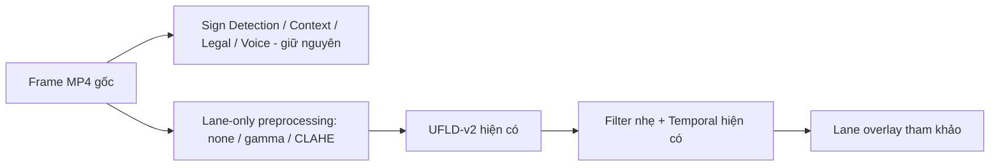

# ITAS-MM — Plan thử nghiệm Lane Preprocessing (Hướng B)

**Ngày lập:** 02/11/2026 (GMT+7)  
**Repository:** `BANGPC123/itas-mm-scaffold`  
**Nhánh thử nghiệm:** `experiment/lane-preprocessing-20261102`  
**Nhánh nguồn:** `fix/lane-simplified-demo-20261102` @ `f6bdf8f51c0171d480d17bb786a01aa56df6c86f`  
**Trạng thái:** PLAN ONLY — chưa triển khai preprocessing, chưa nghiệm thu, không merge.

## 1. Mục tiêu

Thử cải thiện khả năng UFLD-v2 nhận diện **vạch sơn đường thật** trên video MP4 bằng cách điều chỉnh **ảnh đầu vào cho riêng model Lane**, thay vì tiếp tục hạ ngưỡng hoặc retrain.

- Ưu tiên thay đổi nhỏ, có thể bật/tắt, có baseline và rollback rõ ràng.
- Giữ nguyên UFLD-v2 checkpoint, ngưỡng `display_row_ratio: 0.5`, hình học canonical, temporal và lane overlay hiện có.
- Lane chỉ dùng **hiển thị tham khảo**; không suy luận xe lấn làn, không phát cảnh báo lấn làn, không kết luận phạm vi pháp lý.
- Không sửa Sign Detection, Legal/RAG, TTS, frontend, training hoặc dataset trong vòng thử nghiệm này.

## 2. Hiện trạng và lý do thử nghiệm

Đường đi hiện tại của UFLD-v2: **frame BGR → chuyển RGB → resize về 1600×~533 → lấy 320 px dưới → normalize → inference → lane polylines → temporal → overlay**. Cần đặc biệt giữ đúng ánh xạ tọa độ vạch từ ảnh đã xử lý về frame gốc nếu sau này thay crop.

Từ evidence đã ghi ở nhánh nguồn:

| Clip | Số mẫu có lane, ratio 0.5 | Quan sát trên 30 frame chọn trước |
|---|---:|---|
| Ngày, 60 s | 8/360 (2,2%) | Không có vạch được AI chấm đúng |
| Đêm, 90 s | 178/540 (33%) | Có 3 đường được AI chấm đúng |
| Hai clip gộp | — | 3 đúng, 9 sai, 2 không chắc |

Thử giảm ngưỡng còn 0.35 / 0.25 chỉ tăng đường sai, nên **không chọn**. Các con số trên là đánh giá trực quan AI, **không phải accuracy/precision/recall chính thức** và không có human ground truth.

## 3. Chiến lược thử nghiệm theo từng giai đoạn

### Giai đoạn 0 — Khóa baseline và dữ liệu so sánh

1. Giữ nguyên commit nguồn, model weights, config ratio 0.5 và video gốc; ghi SHA/phiên bản cho mỗi lần chạy.
2. Dùng đúng 2 clip đã có evidence: demo ngày 60 giây và đêm 90 giây.
3. Tái sử dụng **30 mốc frame đã khóa trước** từ `LANE_RELAX.md`, không đổi mẫu sau khi xem kết quả. Kiểm tra thêm các mốc lỗi rõ ràng (ví dụ 55 s, 59 s ban ngày) như **diagnostic frames**, không cộng vào 30 mốc nghiệm thu.
4. Ghi baseline: lane coverage, số đường đúng/sai/không chắc, thời gian xử lý, dấu vết sign/context/speech/camera_view và decode video.

### Giai đoạn 1 — Thử preprocessing nhẹ, mỗi lần chỉ đổi một biến

| Biến thể | Phạm vi thử | Lưu ý |
|---|---|---|
| **A0 — Baseline** | Giữ nguyên đầu vào | Mốc bắt buộc để đối chiếu |
| **A1 — Gamma** | Thử tăng sáng nhẹ cho **ảnh dùng bởi UFLD-v2** | Không tăng sáng toàn frame gửi cho model biển báo |
| **A2 — CLAHE** | Tăng tương phản cục bộ trên kênh độ sáng của ảnh Lane | Kiểm tra nhiễu, bóng đổ, ánh đèn và mép lề |

Chạy cùng video, sampling, output FPS, checkpoint và ngưỡng. **Không cộng dồn Gamma + CLAHE** trong vòng đầu. Các giá trị thử phải được ghi rõ trong evidence và có lựa chọn `none` để quay về baseline.

### Giai đoạn 2 — Chỉ khi giai đoạn 1 không đủ: thử crop/resize

- Trước tiên xác nhận vạch thật có bị loại bởi vùng crop 320 px dưới hay không.
- Chỉ thử **một thay đổi crop/resize ở mỗi lượt**, không thay đồng thời ngưỡng hoặc filter.
- Bắt buộc kiểm tra ánh xạ tọa độ về frame gốc; lỗi overlay lệch vị trí là FAIL.
- Nếu không chứng minh được crop gây bỏ sót vạch, **bỏ qua** giai đoạn này.

### Giai đoạn 3 — So sánh và chọn phương án

- Đếm coverage trên toàn bộ 360 mẫu ngày và 540 mẫu đêm, nhưng **không dùng coverage làm thước đo độ đúng**.
- So sánh trực quan trên đúng 30 mốc cố định: **ĐÚNG / SAI / KHÔNG CHẮC** cho từng đường; ghi nhận riêng đường đi qua xe, lề, bóng đổ, vỉa hè.
- Giữ các case UFLD trả 0 anchor trong nhóm chẩn đoán, vì preprocessing có thể không cứu được.
- Nếu có clip chưa dùng để chọn cấu hình, kiểm tra thêm như holdout; tuyệt đối không gọi đây là kết quả tổng quát hóa nếu không có GT người.

## 4. Ranh giới kiến trúc

**Quan trọng:** Ảnh gốc của Sign Detection không được thay. Nhưng vì `camera_view` hiện vẫn liên quan đến UFLD/camera-aware, **không được tự suy ra rằng UC1 bất biến**. Phải đối chiếu kết quả từng sample trước/sau; nếu đổi `camera_view`, sign applicability, context hoặc speech thì coi là hồi quy và không chọn cấu hình đó. Nếu cần tách luồng riêng, chỉ làm thay đổi tối thiểu và có test xác nhận.

## 5. Tiêu chí PASS / FAIL đã chốt trước khi chạy

### PASS cho **thử nghiệm kỹ thuật**

- Cùng nguồn MP4, tất cả output giải mã đủ frame, không crash, không xuất hiện NaN/out-of-frame/misaligned overlay.
- Test liên quan và regression hiện có PASS.
- Kết quả Sign Detection: **0 khác biệt ngoài dự kiến** về bbox, label, full sign/context, `camera_view` và speech/cue trên các mẫu so sánh (360 ngày, 540 đêm).
- Có bảng đối chiếu baseline và từng biến thể, 30 frame đánh giá cố định, bản ảnh so sánh và log/receipt có thể kiểm tra lại.

### PASS để **đề xuất merge preprocessing**

Một biến thể chỉ được đề xuất nếu đạt **đồng thời**:

1. Số đường được chấm **ĐÚNG trên 30 frame** tăng so với baseline (baseline: 3), **trong đó có ít nhất 1 đường đúng ở clip ngày** (baseline ngày: 0).
2. Số đường được chấm **SAI không tăng** so với baseline (baseline: 9); đường qua thân xe/nhầm lề rõ ràng không được tăng.
3. Không hồi quy Sign/Legal/Voice/camera_view; overlay tọa độ đúng; MP4 full decode PASS.
4. Thời gian xử lý được báo cáo với cùng điều kiện. Nếu tăng đáng kể, phải nêu trade-off; **không tự nhận là nhanh hơn từ phép đo một lần**.

**FAIL / rollback:** Nếu không có biến thể đạt đủ tiêu chí thì giữ pipeline hiện tại, kết luận "preprocessing chưa cải thiện đủ trên bộ clip thử", không gộp thay đổi runtime.

Lưu ý: các đánh giá ĐÚNG/SAI ban đầu do AI thực hiện, không phải ground truth người. Trước khi gọi đây là nâng độ chính xác thực tế cần có đánh giá độc lập; nghiệm thu demo chỉ công nhận cải thiện trực quan trên clip thử.

## 6. Phạm vi sửa dự kiến (không triển khai trong commit plan)

- Ưu tiên thêm một tùy chọn preprocessing **chỉ cho Lane / offline MP4** tại vị trí xử lý ảnh trước UFLD-v2.
- Tái sử dụng pipeline UFLD, temporal, renderer, tests và logging hiện có.
- Chỉ bổ sung test nhỏ cho preprocess/khả năng tắt và các phép so sánh E2E cần thiết.
- Tránh thay đổi layout frontend, thay model, kiến trúc hoặc thêm nhánh inference mới.
- Không sửa nhánh `main`, `work/final-20261102` và `fix/lane-simplified-demo-20261102` trong giai đoạn thử nghiệm.

## 7. Git workflow, bàn giao và merge gate

1. Tạo nhánh **`experiment/lane-preprocessing-20261102` từ `f6bdf8f`** và commit file plan này trước.
2. Các commit thử nghiệm tiếp theo **chỉ nằm trên nhánh experiment**, ghi rõ phương án A0/A1/A2, config, kết quả và commit SHA.
3. Không merge trong lúc thử; không tự ý đổi baseline, chồng nhiều preprocessing, hoặc chỉnh báo cáo final để tuyên bố thành công trước nghiệm thu.
4. Handoff tối thiểu: bảng so sánh, 30 frame/ảnh ghép, log pytest/Node, sign regression trên 900 mẫu, checksum input/output, video full-decode, lý do chọn hoặc bác bỏ biến thể.
5. Chỉ sau khi review **PASS toàn bộ merge gate** và được người phụ trách đồng ý mới đề xuất PR từ nhánh experiment → `fix/lane-simplified-demo-20261102` (hoặc nhánh tích hợp được chỉ định khi đó). **Không merge thẳng vào `main`/final.**
6. Nếu FAIL, giữ branch/evidence nghiên cứu và **không chuyển code preprocessing vào nhánh gốc**.

## 8. Trạng thái thực tế khi lập plan

- **Chưa có kết quả thử Gamma/CLAHE/crop.** Không ghi PASS hiệu quả hay tăng accuracy.
- Chỉ được phép đánh giá kết quả sau khi thực thi thử nghiệm và đối chiếu evidence.
- File này chỉ là hướng dẫn triển khai và tiêu chí nghiệm thu; **không thay đổi runtime trong commit plan**.
