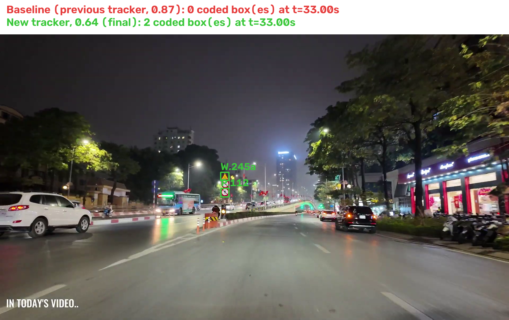
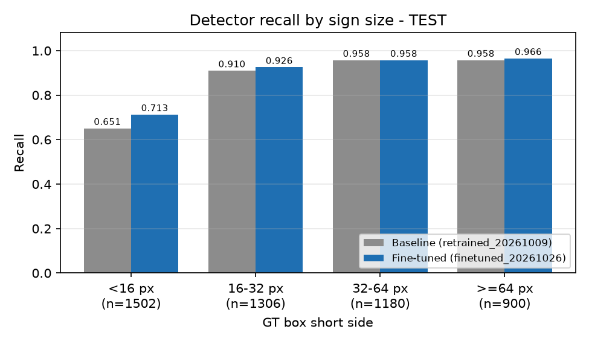
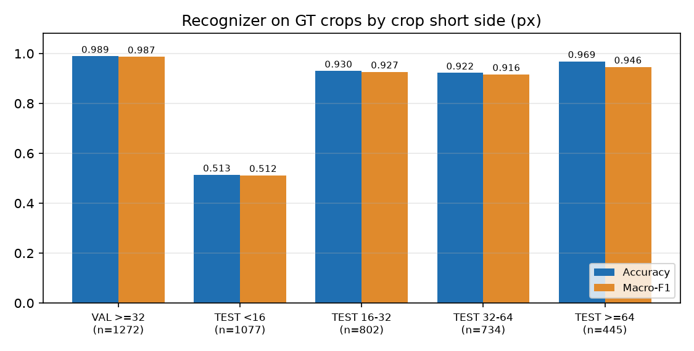
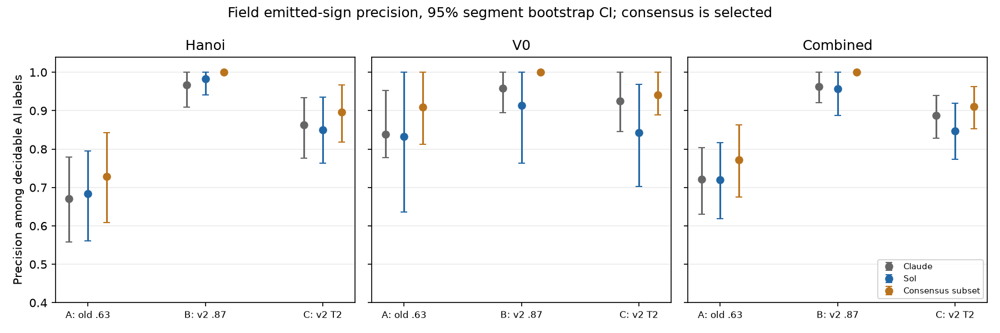
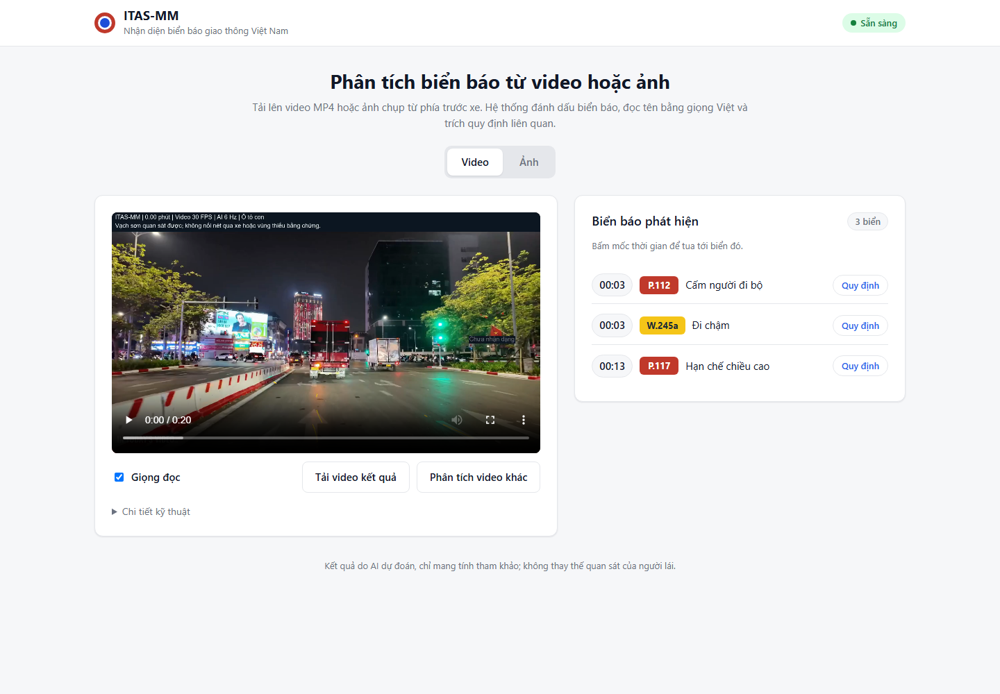
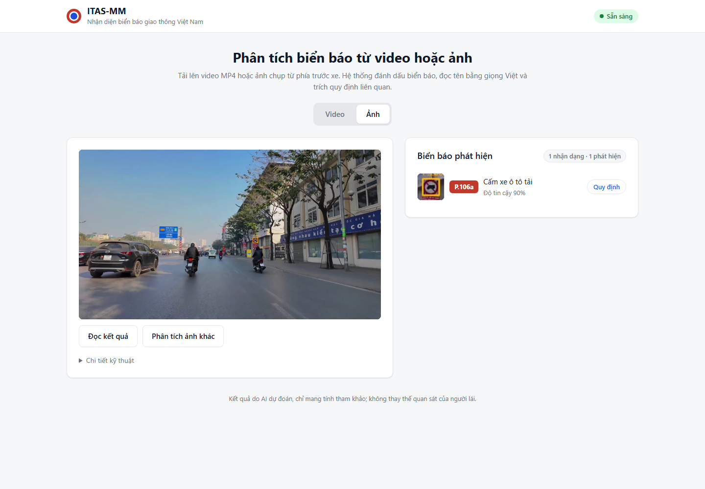

# ITAS-MM: An Intelligent Multimodal Traffic Assistance System for Real-Time Traffic Sign Recognition, Lane Detection, and Legally Grounded Driving Guidance

DSP391m Data Science Capstone — Final Report

Scope note: ITAS-MM is a research prototype. It processes uploaded forward-camera video and still images offline, in a web application. It is not a certified driver-assistance system, is not validated on the road, and its outputs must not be used to drive a vehicle. Every number below comes from the data set, protocol and date given next to it. Sign-code labels are AI-assisted labelling; no human ground truth exists for the full data set.

## 1. Project Title

ITAS-MM: traffic sign recognition, lane visualisation and retrieval-grounded spoken guidance from a single forward camera, with a Vietnamese QCVN 41:2024 sign catalogue of 87 codes.

## 2. Team Members

| Name | Student ID | Role |
|---|---|---|
| Trần Anh Kiệt | SE182050 | Detector and lane model training and evaluation; finalisation of the demo application |
| Phan Khánh Băng | SE180630 | Outline, literature review, objectives and scope; consolidation of the written report |
| Cao Trần Tiến | SE184692 | Detector and lane model training and evaluation; finalisation of the demo application |

## 3. Introduction and Background

**Objective.** Build a system that reads traffic signs from a forward camera, relates the detected sign to the Vietnamese traffic rules that govern it, and gives short spoken guidance, with a lane overlay as visual context.

**Motivation.** Most driver-assistance pipelines stop at detection: they output a class name such as a sign code, but not what the sign requires at that place. Road traffic crashes still kill about 1.19 million people a year [1], and the proposal argues that much of the risk comes from drivers missing or misreading safety-critical information rather than from a lack of sensing. Spoken, legally grounded feedback is one way to reduce glance time.

**Background.** The project began as a four-stage design: perception, road-zone context, retrieval-augmented reasoning and speech. The final web application accepts an uploaded video or image, runs perception and an offline video pipeline, retrieves legal passages from three official sources, and reads sign names aloud in Vietnamese. Road-zone context uses simulated GPS only, and lane output is visual context only. A real-time streaming prototype was built during the project but is not part of the final application (Section 13).

## 4. Literature Review

Traffic sign detection and recognition has moved to end-to-end deep learning. YOLO-family detectors are widely used. Lane detection has shifted from pixel segmentation to row-wise and structure-aware classification, which trades a little accuracy for speed; Ultra-Fast Lane Detection is the reference point [2][3]. Small and distant objects remain the weak spot of single-pass detectors. Slicing-aided inference (SAHI) recovers some of that recall without retraining [4], and recent Vietnamese work reports the same small-sign problem in dense urban traffic [5].

Retrieval-augmented question answering on Vietnamese traffic law is an emerging line of work: a training-free multi-stage pipeline [6], a graph-based retrieval system [7], and a shared task on multimodal legal QA over traffic-sign regulation [8]. These works evaluate retrieval as a standalone QA task. Voice delivery is mature: Vietnamese neural text-to-speech such as VieNeu is open [9], and voice-plus-vision assistive systems exist [13].

**Gap addressed.** Detection systems output labels without the governing rule; legal-QA systems answer questions without a live detector; few systems combine a real-time sign detector, a grounded rule lookup and spoken output. Cognitive load is a further concern for purely visual alerts [14]. ITAS-MM combines the three parts in one pipeline, with a neutral observation wording and explicit labels for what is unverified. It does not claim legal applicability.

## 5. Data Description

**Sources.**

- Five public Vietnamese traffic-sign data sets (four Kaggle sets and one Roboflow set), merged with provenance tracking, exact-duplicate removal and lineage grouping. Reported licences were recorded as published; media are not redistributed in the repository.
- A canonical localisation set of 15,603 images and 30,558 boxes.
- A field pilot of 120 frames (66 signs) from one development driving video, with boxes reviewed by one team member and no review of sign codes.
- Three field-evaluation videos recorded in Hanoi (forward-camera footage, two day and one night). The evaluation used 15 segments of 60 seconds each (3 videos × 5 segments). These are unannotated and used for behaviour measurements only.
- Three official legal sources (Law No. 36/2024/QH15, Decree No. 168/2024/ND-CP and QCVN 41:2024/BGTVT). The offline index holds 703 page-grounded chunks from four official PDFs.

**Size and format.**

| Item | Size | Format |
|---|---:|---|
| Canonical localisation set | 15,603 images, 30,558 boxes; TRAIN 10,952 / VAL 2,325 / TEST 2,326 images | JPEG/PNG images, YOLO-style labels |
| Recognition manifest V1.1 | 10,003 crops over 30 codes; TRAIN 5,673 / VAL 1,272 / TEST 3,058 | Crop images with CSV manifest |
| Recognizer v2 training crops | 17,445 TRAIN and 3,933 VAL crops over 87 codes (plus background) | Crops, manifest JSON |
| Field evaluation | 15 segments × 60 s at 6 Hz | MP4 and JSONL predictions |

**Features.** Each sign detection carries a bounding box (x1, y1, x2, y2), detector confidence, sign code, recognition confidence, the raw top-1 label and raw score (added for this final version), a track identifier, and a panel role. Each frame carries a timestamp and the lane polylines.

## 6. Data Cleaning and Preprocessing

- **Duplicates and leakage.** Exact duplicates were removed. Splits were made by lineage group, so near-duplicate frames never cross TRAIN, VAL and TEST. Frozen split fingerprints are recorded in the dataset manifest, and TEST was not used for tuning.
- **Size filters.** TRAIN and VAL recognition crops use a native short side of at least 16 px for the v2 recognizer; TEST keeps all sizes for evaluation. Runtime applies a minimum crop size of 32 px on images and 12 px on video.
- **Ontology extension.** Boxes outside the original 30-code ontology were coded with 87 QCVN codes by two AI passes against official figure crops. A box is used only if both passes agree: 976 boxes (TRAIN 553, VAL 120, TEST 303). Raw agreement was 76.9%. The other 555 boxes stay excluded.
- **Name coverage.** Every one of the 87 recognised codes has a Vietnamese display name. Several names are shared by more than one code where the source gives no distinct wording, for example I.407 and I.407a, and R.302a and R.302b.
- **Challenges.** The main challenges were small crops (below 16 px, which are sparsely labelled and hard to read), label noise from AI-assisted labelling, and a domain gap between curated images and real driving video. Each challenge is quantified in Section 10.

## 7. Exploratory Data Analysis

- **Size distribution.** Boxes shorter than 16 px make up 1,502 of 4,888 TEST boxes (31%). They are the largest source of misses (Section 10.1).
- **Class support.** The recognizer has 55 main classes with enough training data and 32 low-support classes, which are trained but reported separately (Recognizer v2 notes, 28 October 2026).
- **Recogniser by crop size.** Accuracy rises sharply with crop size: on TEST crops below 16 px the original recognizer reaches 0.514 accuracy and the v2 recognizer 0.784; at 32 px and above, both reach 0.937 and 0.970 respectively.
- **Confusions.** Errors concentrate in visually similar pairs: P.137 (no left and right turn) is confused with P.123b in 39 of 73 crops, and W.201a with W.203c in 5 of 17.
- **Real video versus dataset.** On the field pilot, precision of the baseline detector is 0.641, against 0.923 on the dataset TEST split. The gap is the main domain-shift finding.

## 8. Methodology

**Model selection.** The detector is a single-class YOLO11n model. Localisation and classification are separated: the detector finds every panel, and a separate MobileNetV3-small classifier assigns the code. This keeps localisation independent of the class vocabulary, and the classifier can reject uncertain crops through a background class and a threshold. MobileNetV3-small has 1.56 M parameters, which keeps the classifier cheap next to the detector on the 4 GB development GPU.

**Data splitting.** A fixed, lineage-grouped TRAIN/VAL/TEST split is used. K-fold cross-validation was not used: each detector fold would take about 25 minutes on the available GPU, and random folds would break the lineage grouping. Uncertainty for the detector comparison is quantified with a paired image-level bootstrap on TEST (1,000 resamples).

**Feature engineering and temporal evidence.** A single frame can misread a sign, so video decisions use multi-frame evidence:

- Each frame's detections are matched to existing tracks by overlap, with a fallback that matches by centre distance and size ratio regardless of the label. Matching is one-to-one.
- Each track keeps a ballot count per code within a time window. A code is confirmed when it leads by a minimum number of votes and by at least one vote over the runner-up. One conflicting read no longer cancels a confirmed code.
- Hard vetoes (for example, unsupported symbol shape) clear the ballots.
- The threshold for video can be set separately from still images (`video_confidence_threshold`).

**Lane.** UFLD-v2 ResNet-18 with light sanity filtering (finite, in-image, at least 3 points) and temporal smoothing; visual context only, no surface veto in the final upload mode. In the uploaded-video result, lane lines are updated on alternate analysis samples (3 Hz), while signs are analysed at 6 Hz.

## 9. Model Development

**Architecture.**

| Component | Architecture | Size | Input / output | Notes |
|---|---|---|---|---|
| Sign detector | YOLO11n | 2.59 M parameters | 640 px (960 px multi-scale on video); 1 class | `finetuned_20261026.pt` (default) |
| Sign recognizer | MobileNetV3-small | 1.56 M parameters | 128 px crop; 87 codes + background | `retrained_20261028.pt`; checkpoint threshold 0.87 |
| Lane | UFLD-v2 ResNet-18 with light sanity filtering and temporal smoothing; no surface veto in upload mode | CULane-trained weights | lane polylines | visual context only |
| Legal retrieval | BM25 with positional bigram/trigram evidence | 703 chunks, four official PDFs | ranked legal locators | no text generation |
| Speech | VieNeu v3 ONNX | - | Vietnamese MP3, cached by text | offline |

**Training procedure.**

- Detector: three successive stages on the same YOLO11n model (baseline, a short retraining with AdamW at 1e-4, and a fine-tuning stage with AdamW at 1e-3, final learning rate factor 0.01). The final stage ran for 10 epochs in 23 min 10 s on a 4 GB RTX 3050 Laptop GPU with batch 16, 640 px and AMP. Horizontal flips are off, because they would swap left-turn and right-turn signs.
- Recognizer v2: 30 epochs, seed 20261028, batch 128, 14,000 sampled crops per epoch, learning rate 0.0004, AdamW with OneCycleLR; selection by VAL main-class macro-F1 and threshold calibration. TEST was used for reporting only. The original checkpoint's VAL macro-F1 of 0.9511 was reproduced locally at 0.9500 (difference −0.0011), with the same selected epoch (18) and threshold (0.87).
- The recognizer was not retrained for the final version; the final version only changes the video decision logic and the threshold configuration.

**Pipeline changes in the final version.**

- Raw recognition fields (`raw_label`, `raw_score`) are kept on every detection, so a rejected crop can be explained.
- Track matching and ballot voting were replaced as described in Section 8.
- The result video carries spoken cues. Signs detected within 1.5 seconds of each other are read as one cue of at most two codes; further signs in the same cluster are read right after it. Each cue plays when the result video reaches its time.
- An earlier optimisation step: the result video is written at 30 FPS. Together with the lane update rate above, this cut processing time for a 90-second clip from 406.3 s to 165.0 s on the same machine; sign results did not change (Section 10.7). A later change, the simplified lane path described in Section 8, reduced processing of a 60-second clip (1,800 frames at 30 FPS) from 171.7 s to 77.9 s in a script run on the same machine, with sign boxes, labels, context and speech identical in all 360 analysed samples; a web upload of a re-encoded copy of that clip took 127.9 s. These are single runs (evidence/LANE_SIMPLE.md). On the 90-second night clip, the simplified lane path took 153.3 s in one run, 1.7 times real time (evidence/SPEED.md).
- Videos longer than 100,000 frames are refused with a message asking the user to trim them.

## 10. Model Evaluation and Fine-Tuning

### 10.1 Evaluation metrics and protocol

| Module | Metrics | Protocol |
|---|---|---|
| Detector | Precision, recall, mAP50, mAP50-95; recall by box size | Confidence 0.35, NMS IoU 0.45, match IoU 0.50, 101-point AP |
| Recognizer | Accuracy, macro-F1, confusion matrix | Ground-truth-box crops, grouped by crop short side |
| Field pilot | Precision, recall | 120 frames, boxes reviewed by one team member |
| Field A/B/C comparison | Precision with cluster bootstrap CI | Emitted confirmed items; two AI-assisted reviewers |
| Field segment evaluation | Track counts, coded tracks, confirmation time, FPS | 15 × 60 s segments at 6 Hz |
| Runtime | ms per request, FPS | Measured on the original (non-overlay) video |
| Legal retrieval | Recall@1/3/4, MRR | 24-case development suite |

### 10.2 Detector fine-tuning

| Split | Model | Precision | Recall | mAP50 | mAP50-95 |
|---|---|---:|---:|---:|---:|
| TEST | Baseline | 0.9232 | 0.8509 | 0.9194 | 0.7168 |
| TEST | Fine-tuned | 0.9361 | 0.8754 | 0.9357 | 0.7360 |

The paired bootstrap on TEST gives recall +0.0245 (95% CI [0.0170, 0.0317]) and mAP50 +0.0163 (95% CI [0.0122, 0.0198]). Both intervals exclude zero. Recall for boxes below 16 px rose from 0.651 to 0.713; for boxes of 32 px and above it is about 0.96.

### 10.3 Recognizer results

On TEST crops of 32 px and above, the v2 recognizer reaches accuracy 0.9697 (original: 0.9371) and macro-F1 0.9594 (original: 0.9056). Over all TEST crops, accuracy rises from 0.7904 to 0.9090.

Operating points on TEST crops of 32 px and above (original 30-code evaluation):

| Setting | Accepted | Correct | Coverage | Correct / accepted | Correct / all |
|---|---:|---:|---:|---:|---:|
| Original, threshold 0.63 | 1,223 | 1,169 | 0.9745 | 0.9558 | 0.9315 |
| v2, threshold 0.87 | 1,134 | 1,121 | 0.9036 | 0.9885 | 0.8932 |
| v2, threshold 0.64 | 1,207 | 1,186 | 0.9618 | 0.9826 | 0.9450 |

The v2 recognizer covers more crops at 0.64 with higher correct-over-all than the original model. These numbers use AI-assisted labels, so they measure agreement with those labels, not expert accuracy.

### 10.4 Operating point for video

On video each sign is seen in many frames, so a lower per-crop threshold can be compensated by multi-frame voting. An earlier comparison on the combined field A/B/C population favoured 0.87 (precision 0.963 against 0.887 at 0.64). The final system uses 0.64 on video to recover more signs: on the 52 tracks that 0.64 adds over 0.87 on the 15 field segments, 39 were judged correct, 4 wrong and 9 undecidable from the crop (90.7% of decided tracks; 75.0% if undecidable tracks are counted as wrong). Still images keep 0.87.

### 10.5 Field segment evaluation

Four configurations were run on the same 15 segments: the baseline (previous tracker at 0.87, taken from the earlier evaluation of 29 October 2026), the new tracker at 0.87, at 0.75 and at 0.64.

| Config | Physical tracks | Tracks with a code | Distinct codes | Median confirmation (ms) | Inference FPS (median) |
|---|---:|---:|---:|---:|---:|
| Baseline (previous tracker, 0.87) | 1,205 | 75 | 15 | 333 | 2.82 |
| New tracker, 0.87 | 846 | 75 | 15 | 333 | 3.05 |
| New tracker, 0.75 | 839 | 86 | 20 | 333 | 3.00 |
| New tracker, 0.64 (final) | 834 | 96 | 23 | 333 | 3.01 |

The new tracking reduces track fragmentation: tracks with fewer than three samples fall from 1,022 (baseline) to 637 (0.64 setting). The threshold, not the tracker, limits how many signs are coded: at 0.87 the coded count stays at 75 with the new tracker. Median confirmation time is 333 ms in all four configurations, which equals two frames at 6 Hz, so it reflects sampling rather than the threshold. Coded tracks are not graded as correct or incorrect here. The 0.75 and 0.64 settings add 11 and 21 coded tracks over the baseline respectively.

### 10.6 Field pilot

On the 120-frame field pilot, the fine-tuned detector raises precision from 0.641 to 0.729 and keeps recall near 0.77 (recall 0.758 → 0.773). The pilot is small: 66 signs from one video, with boxes from bulk approval of detector proposals and no review of sign codes or lanes.

### 10.7 Runtime

| Measurement | Result | Source |
|---|---|---|
| Prototype, not part of the final application: live request, lane overlay off (original clip, 115 frames after warm-up) | p50 78.9 ms, p95 618.1 ms | re-measurement, 31 Oct 2026 (Appendix E) |
| Prototype: live request, lane overlay on (same clip) | p50 271.7 ms, p95 843.0 ms | same |
| Offline pipeline per image (detection, recognition, lane, context, retrieval; audio off) | 46.2 ms (21.7 FPS) | Report 3, VI.5 |
| Detector, fine-tuned | 10.8 ms per image (92.7 FPS) | Report 3, VI.5 |
| Uploaded video, 90-second clip, current simple lane path (2,700 frames at 30 FPS) | 153.3 s processing, 1.7 times slower than real time (one run); earlier speed step: 165.0 s, 1.8 times | speed check, 2 Nov 2026 (evidence/SPEED.md); earlier step 1 Nov 2026 (Appendix E) |
| Uploaded video, same clip, before the speed change (5,400 frames at 60 FPS) | 406.3 s processing, 4.5 times slower than real time; an earlier run on 31 Oct 2026 took 301.2 s (3.3 times) | speed check, 1 Nov 2026; job summary, 31 Oct 2026 |
| Uploaded video, 20-second night clip through the web interface, after the speed change | 44.6 s processing | speed check, 1 Nov 2026 |

The prototype's p95 values include text-to-speech in the measured total, so they are an upper bound for its visual path. The speed change did not change sign results: 540 of 540 analysis samples have the same sign boxes and labels before and after.

### 10.8 Legal retrieval

On 24 development cases, Recall@1 is 0.542, Recall@3 0.833, Recall@4 0.875 and MRR 0.684. The suite is a development regression set. The corpus has not been checked for legal currency: each result is returned with `legal_currency_verified: false`.

## 11. Results Interpretation and Visualization

**What the final system does.** On uploaded forward-camera video, the system detects sign panels, confirms codes across frames, and produces a verified MP4 with a spoken cue for each confirmed group of signs and a timed list of the signs. On a single image, it reports each detected panel with its code and confidence, reads the result aloud, and looks up the cited legal passages. The offline segment runs measured about 3 FPS of inference, and processing is slower than real time (1.7 times for a 90-second clip, Section 10.7).

**Three overlapping signs (case study).** In a night clip from Hanoi (source 31.7–34.8 s), three panels are stacked on a pole. The baseline read none of them (0 coded boxes at 33.0 s). The final configuration reads two of them, P.112 and W.245a (Figure 1). The third panel is not read by either configuration, and this is a limit of the recognizer on low-support classes, not of the threshold.

**Small signs remain the main weakness.** Figure 2 shows detector recall by box size: below 16 px recall is 0.713 after fine-tuning, while 32 px and above reach about 0.96. Distant signs are the largest source of misses, matching the small-object problem in the proposal.

**Recognizer accuracy depends on size.** Figure 3 shows accuracy by crop short side. Below 16 px the original recognizer is near 0.51 and the v2 recognizer near 0.78; from 32 px up both are high.

**Field precision and its uncertainty.** Figure 4 shows the field precision comparison with cluster bootstrap intervals (Report 3, Figure 7). The population is small and the two AI-assisted reviewers disagree on denominators, so the intervals are descriptive.

**Web interface.** Figures 5 and 6 are screenshots of the final upload-only interface, taken on 1 November 2026 at a 1440 px desktop width. Figure 5 shows the result for a 20-second night clip: the result video, the timed sign list and the voice toggle. Figure 6 shows the result for a daytime still image: the annotated image and the detected panel with its confidence.

**Interpretation.** Three conclusions are supported by the measurements:

- Coded output rose mainly with the threshold: on the same tracker, coded tracks went from 75 at 0.87 to 96 at 0.64. The new tracker reduced fragmentation (1,205 to 834 physical tracks) without changing the coded count at 0.87.
- The threshold trades coverage for precision on video. The 0.64 threshold was accepted on a small sample of new tracks; this is a judgement that should be checked with more graded tracks before any claim about field precision.
- Dataset metrics overstate field performance: the detector's precision falls from 0.923 on TEST to 0.641 on the field pilot.

## 12. Conclusion and Recommendations

**Key findings.**

1. The detector's fine-tuning improved every TEST metric, with statistically supported gains in recall (+2.5 points) and mAP50 (+1.6 points).
2. The recognizer covers 87 codes and is accurate on crops of 32 px and above (0.970 accuracy on TEST). Its weakest range is below 16 px.
3. Video confirmation is more stable with the new tracker: tracks with fewer than three samples fall from 1,022 to 637 on the same 15 segments.
4. The video threshold of 0.64 gives 96 coded tracks against 75 at 0.87, with 90.7% precision on 43 decided new tracks. This is based on one reviewer and a small sample.
5. The upload pipeline is slower than real time: 1.7 times for a 90-second clip with the simplified lane path (153.3 s of processing, one run), down from 4.5 times on the same clip before the speed changes.

**Recommendations.**

1. Grade more tracks with a second independent reviewer before relying on the 0.64 threshold; if precision stays below 85%, return to 0.87.
2. Target small signs directly: evaluate the SAHI tiling path and add crops of 16–32 px to recognizer training, tuned on VAL only.
3. Add training examples or a dedicated rule for the P.137 / P.123b pair and for W.201a / W.203c.
4. Build a source-disjoint field test set with human-reviewed boxes, codes and lane annotations before reporting field accuracy.
5. Add OCR for the scanned decree so its articles become retrievable.

**Reflection.** The largest practical problem was reproducibility: weights and evaluation artefacts lived on individual machines. Pinning model and data hashes and recording the command for each metric made the results re-runnable on the same machine, but an independent-machine restore has not been done. The second problem was measurement: the earlier benchmark script did not apply the threshold to the video path. The new configurations were run with a corrected copy; the baseline run was taken from the earlier evaluation of 29 October 2026.

## 13. Limitations and Future Work

- **Scope of signs.** The recognizer covers 87 codes: 55 main classes with enough training data and 32 low-support classes. Codes outside this list are not recognised, and the QCVN 41:2024 catalogue is not fully covered. The detector finds panels regardless of code.
- **Small and night signs.** Signs below about 32 px and at night are missed more often (Section 10.2, Figure 2).
- **Labels.** Sign-code labels are AI-assisted labelling, not ground truth by independent human annotators. Some shared names are shown as group names: for example, R.301a/c/d/e, W.205a/b/d, P.106a/b, W.202/W.202a, R.302a/b and I.407/I.407a are not separated into their variants.
- **Precision.** The field precision figures (90.7% on 43 decided new tracks; 0.9633 for the 0.87 setting on the combined Report 3 population) come from one or two AI-assisted reviewers and small samples. They are not independent measurements.
- **Threshold.** The video threshold favours coverage over precision. The 90.7% figure comes from one AI-assisted reviewer on 52 tracks and needs a larger, independently graded sample.
- **Lane.** Lane overlays are visual context only. There is no human-reviewed Vietnamese lane ground truth, lanes are not classified as dashed or solid, and lanes are not used to decide which sign applies. On the 60-second demo clip the CULane-trained UFLD-v2 returned lane lines in 8 of 360 samples, some on kerbs or parked cars; on the 90-second night clip, lines were shown in 178 of 540 samples (coverage, not accuracy). Lowering the UFLD row-existence threshold to 0.35 and 0.25 was tested but did not improve enough to meet the selection rule on 30 preselected frames assessed by AI visual review (evidence/LANE_RELAX.md).
- **Real time.** Real-time streaming analysis (live camera or live playback) was prototyped but is not part of the final application; uploaded video is processed about 1.7 times slower than real time on the test machine (153 s for a 90-second clip, one run). Offline segment runs measured about 3 FPS of inference.
- **Supplementary panels.** Supplementary panels (time windows, vehicle types, distances) are not read in the final build. The OCR component works in isolation (it read a "100m" distance panel correctly) but is disabled: its parser covers only time windows and vehicle types, results are not shown, and night panels were unreadable. Sign applicability is therefore reported as uncertain.
- **Legal retrieval.** Legal retrieval sometimes ranks a general article above the article for the detected sign.
- **Legal and GPS.** GPS is simulated. The legal corpus has not been checked for current effect (`legal_currency_verified: false`). The system is not legal advice and not a driving-safety system.
- **Future work.** More output classes; human-labelled test sets; a stronger tracker (for example, ByteTrack-style association); lane attributes (dashed/solid) in a BDD100K-like schema; supplementary-panel OCR with a dedicated test set; real-time streaming on GPU with a lighter lane model and frame skipping; speed optimisation (TensorRT or ONNX); real GPS.

## 14. References

[1] World Health Organization, *Global status report on road safety 2023*, Geneva: WHO, 2023.

[2] Z. Qin, H. Wang and X. Li, "Ultra Fast Structure-aware Deep Lane Detection," *European Conference on Computer Vision (ECCV)*, 2020.

[3] Z. Qin, P. Zhang and X. Li, "Ultra Fast Deep Lane Detection With Hybrid Anchor Driven Ordinal Classification," *IEEE Transactions on Pattern Analysis and Machine Intelligence*, 2022.

[4] F. C. Akyon, S. O. Altinuc and A. Temizel, "Slicing Aided Hyper Inference and Fine-tuning for Small Object Detection," *IEEE ICIP*, 2022, pp. 966–970.

[5] D. Nguyen, H. V. Dung, V.-T.-L. Le and T. Doan, "Traffic Sign Detection in Vietnam: An Experimental Study," *18th National Conference on Fundamental and Applied Information Technology Research*, 2025.

[6] P. X. Pham, D. Q. Le, T. H. Tran and T. N.-T. Huynh, "LexiSignVQA: A Unified Training-free Multi-stage Approach to Multimodal Legal Question Answering on Traffic Sign Rules," *VLSP 2024*, 2025.

[7] H. M. Huynh, A. N. T. Khuong, D. P. Trong and T. V. Huynh, "Reading the Signs: A Graph-Based System for Multimodal Information Retrieval on Vietnamese Traffic Law," *VLSP 2024*, 2025.

[8] S. T. Luu et al., "VLSP 2025 MLQA-TSR Challenge: Vietnamese Multimodal Legal Question Answering on Traffic Sign Regulation," 2025.

[9] pnnbao97, "VieNeu-TTS: A Vietnamese Neural Text-to-Speech System," GitHub, 2024.

[10] National Assembly of the Socialist Republic of Vietnam, *Law on Road Traffic Order and Safety*, Law No. 36/2024/QH15, effective 1 January 2025.

[11] Government of Vietnam, *Decree No. 168/2024/ND-CP* on administrative penalties for traffic order and safety violations, effective 1 January 2025.

[12] Ministry of Transport, *QCVN 41:2024/BGTVT, National technical regulation on road signs and markings*. The proposal cites the 2019 edition; the corpus used here is the 2024 edition.

[13] M.-Q. Tran, D. Truong, D.-T. Pham and M.-A. Nguyen, "NaviBlind: A multimodal AI assistant for visually impaired users to identify product information from images and speech," October 2025.

[14] I. Politis, S. Brewster and F. Pollick, "Age, cognitive load, and multimodal effects on driver response to directional warning," *ResearchGate*, 2017.

[15] Z. Xu, T. Chen and S. Chen, "A LLM-based Multimodal Warning System for Driver Assistance," 2024.

## 15. Appendices

**Appendix A. Automated test results (Python/Node refreshed 2 November 2026).**

| Check | Result |
|---|---|
| `python -m pytest -q tests` (with `PYTHONNOUSERSITE=1`) | 613 passed, 0 failed, 11 skipped, 38 deselected by `pytest.ini`; exit 0 |
| `node --test frontend/src/*.test.js` | 14 passed, 0 failed, 0 skipped, 0 deselected; exit 0 |
| `npm run build` (frontend) | Build succeeded (1 November 2026; not rerun in this experiment) |

Implementation commit: `4e662ab800629508397199e560c919e1fa4c58bb`; the final report commit and suite replay are recorded in `output/lane_relax_20261102/checks_final.json` (evidence/LANE_SIMPLE.md).

**Appendix B. End-to-end checks.** On 31 October 2026, four items passed: server start (1), upload refusal while a job runs (8), legal search with source (9), and server restart with speech (10). Four were partly checked: live API response on the night clip (2, 3), upload job completed with a verified decode and cues (6), and the length and format checks (7). Items 2 to 5 (live boxes, live seek and camera) were removed from the final scope on 1 November 2026. On 1 November 2026 the upload-only interface was checked in the browser with a 20-second night clip and a daytime image: the sign list, the legal lookup and a 390 px mobile layout without horizontal scrolling. Speech playback was not listened to and is not verified by ear. The full table is in `docs/final_report/evidence/E2E_CHECKLIST.md`.

**Appendix C. Demo clips.** Three 90-second clips were cut from the field-evaluation source videos for the demonstration (Hồ Tây day road; Hanoi night with the three-sign overlap; Hanoi day road with many prohibition and warning signs). Sources, source hashes and cut times are listed in `docs/final_report/evidence/SOURCES.md`.

**Appendix D. Number sources.** Every number in this report is listed with its source file in `docs/final_report/evidence/NUMBERS.md`.

**Appendix E. Configuration values and result files.**

- Video threshold, exact value: 0.6412901874067937, set as `video_confidence_threshold` in `configs/perception.yaml`; written as 0.64 in the text. Still-image threshold: 0.87 (recognizer checkpoint).
- Field segment runs in `output/kiet_wp_20261029/field_eval/`: the baseline runs are the folders prefixed `B_`; the new tracker at 0.87, 0.75 and 0.64 are the folders prefixed `N87_`, `N75_` and `N64_`.
- Track grading for the 0.64 setting: `docs/final_report/evidence/track_grading_064.csv` (copy of the grading sheet; 52 tracks, with verdict and note per track).
- Upload speed check (1 November 2026): `docs/final_report/evidence/SPEED.md`.
- Runtime measurement: `docs/final_report/evidence/t9_latency_original.json`. Upload job used for the end-to-end check: `output/offline_video_jobs/a2b1e58883ef41e2a9b12e6c6f987d45/`.

