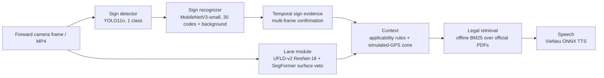

# ITAS-MM - Report 3: Model and Results (Sections IV-VII)

DSP391m capstone, week 8 report. Draft prepared 2026-10-26 on branch `work/kiet-dataset-v2` from the revalidation run documented in [`docs/KIET_REVALIDATION_20261026.md`](../KIET_REVALIDATION_20261026.md). Figures are produced by `scripts/make_report3_figures.py` from local evaluation artifacts.

Scope note: ITAS-MM is a research prototype that processes offline MP4 video. It is not a certified or field-validated driver-assistance system. All numbers below come from the stated datasets and protocols; none is a road-safety claim.

## IV. Model Development

### IV.1 System overview

Perception is split into two stages: a single-class detector localises every traffic-sign panel, and a separate classifier assigns the QCVN sign code. This keeps localisation independent of the class vocabulary and lets the recognizer reject uncertain crops through a background class and a reference gate.

### IV.2 Model architecture

| Component | Architecture | Size | Input / output | Runtime file |
|---|---|---|---|---|
| Sign detector | Ultralytics YOLO11n | 2.59 M parameters | 640 px image (960 px multi-scale on video), 1 class `traffic_sign` | `models/sign_detector/retrained_20261009.pt` (shared default) |
| Sign recognizer | torchvision MobileNetV3-small | 1.56 M parameters | 128 px crop, 31 outputs (30 QCVN codes + background), confidence 0.63, reference-gate margin 0.015 | `models/sign_recognizer/retrained_20261009.pt` |
| Lane | UFLD-v2, ResNet-18 backbone (row-anchor classification) with SegFormer road-surface veto | CULane-trained weights | ego-lane polylines | `models/lane/selected_20261009.pth` |
| Context | Rule-based applicability (vehicle class, supplementary panels) and zone classifier on simulated GPS | - | zone label, applicable rules | `src/context/` |
| Legal retrieval | BM25 with positional bigram/trigram evidence, no generation | 703 page-grounded chunks from 4 official PDFs | ranked legal locators | `src/reasoning/offline_legal_retrieval.py` |
| Speech | VieNeu v3 ONNX (offline) | - | Vietnamese MP3, cached by text | `src/interaction/` |

The lane, context, retrieval and speech modules are integrated in the pipeline but only the detector, recognizer and retrieval have quantitative evaluation in this report (see VII.3).

### IV.3 Data used for training and evaluation

- Source: five public Vietnamese traffic-sign datasets (four Kaggle sets and Roboflow v6), merged with provenance tracking, exact-duplicate removal and lineage grouping.
- Canonical localisation set: 15,603 images and 30,558 boxes. Split by lineage group to prevent near-duplicate leakage: TRAIN 10,952 images / 20,923 boxes, VAL 2,325 / 4,747, TEST 2,326 / 4,888.
- Recognition manifest V1.1: 10,003 crops over 30 released sign codes (TRAIN 5,673, VAL 1,272, TEST 3,058). TRAIN and VAL contain only crops with short side >= 32 px; TEST keeps all sizes for evaluation.
- Sign-code labels were produced by an AI-assisted semantic audit, not by independent human annotators. Detector boxes are the canonical boxes of the source datasets.

### IV.4 Training procedure

Detector (three successive stages, same YOLO11n model):

| Stage | Initialisation | Epochs | Optimiser / lr0 | Augmentation | Selection |
|---|---|---:|---|---|---|
| 1. Baseline | `yolo11n.pt` pretrained weights | 20 | auto / 0.01 | none (mosaic, flips, HSV off) | best VAL fitness |
| 2. `retrained_20261009` | stage 1 | 8 | AdamW / 1e-4 | light HSV and scale | best VAL fitness |
| 3. `finetuned_20261026` (this report) | stage 2 | 10 | AdamW / 1e-3, final lr factor 0.01 | HSV 0.005/0.15/0.15, rotation 2 deg, translate 0.03, scale 0.15; mosaic and flips off | max VAL mAP50-95 |

Stage 3 ran on an RTX 3050 Laptop GPU (4 GB) with batch 16, 640 px, AMP and seed 391; it completed 10/10 epochs in 23 min 10 s without out-of-memory errors. Horizontal flips stay disabled: mirroring would turn left-turn and right-turn signs into each other.

Recognizer: MobileNetV3-small trained on TRAIN sign crops plus background crops, thresholds calibrated on VAL. It was not retrained in this report.

*Figure 4. VAL metrics per fine-tuning epoch (Ultralytics validator). The best epoch is the last one, so the model may not have converged.*

## V. Model Evaluation and Fine-Tuning

### V.1 Evaluation metrics

| Module | Metrics | Protocol |
|---|---|---|
| Detector | Precision, recall, mAP50, mAP50-95; recall by GT box short side | Confidence 0.35, NMS IoU 0.45, match IoU 0.50, 101-point AP, one class |
| Recognizer | Accuracy, macro-F1 over classes with support, confusion matrix | GT-box crops, raw argmax, grouped by crop short side |
| Field pilot | Precision, recall | 120 owner-reviewed video frames, same detector protocol |
| Legal retrieval | Recall@1/3/4, MRR | 24-case development regression suite |
| Runtime | ms per image, FPS | 50 VAL images, CUDA, warm-up excluded, audio off |

### V.2 Hyperparameter tuning

Tuning was limited to one fine-tuning configuration (stage 3 above), chosen to adapt the stage-2 model with a higher learning rate and mild photometric and geometric augmentation. Candidate selection used only VAL mAP50-95; the selected checkpoint was then evaluated once on TEST. No threshold, weight or data choice was changed after seeing TEST. A wider search (learning rate, image size, SAHI tiling) was not run because of the 4 GB GPU budget and schedule.

### V.3 Validation strategy

K-fold cross-validation was not used: each detector fold would cost about 25 minutes on the available GPU, and random folds would break the lineage grouping that prevents leakage between near-duplicate frames. Instead the project uses:

1. a fixed lineage-grouped TRAIN/VAL/TEST split, with TEST reserved for final reporting;
2. a paired image-level bootstrap on TEST (1,000 resamples, seed 20261026) to quantify uncertainty of the model difference;
3. a separate field pilot: 120 frames from a development driving video, reviewed by the project owner.

### V.4 Fine-tuning result

| Split | Model | Precision | Recall | mAP50 | mAP50-95 |
|---|---|---:|---:|---:|---:|
| VAL | Baseline | 0.9211 | 0.8850 | 0.9390 | 0.7347 |
| VAL | Fine-tuned | 0.9409 | 0.9016 | 0.9477 | 0.7553 |
| TEST | Baseline | 0.9232 | 0.8509 | 0.9194 | 0.7168 |
| TEST | Fine-tuned | 0.9361 | 0.8754 | 0.9357 | 0.7360 |

Paired bootstrap on TEST, fine-tuned minus baseline: recall +0.0245, 95% CI [0.0170, 0.0317]; mAP50 +0.0163, 95% CI [0.0122, 0.0198]. Both intervals exclude zero.

*Figure 1. Detector metrics before and after fine-tuning.*

## VI. Results Interpretation and Visualization

### VI.1 Small signs are the main detector weakness

*Figure 2. TEST recall by GT box short side.*

Signs below 16 px make up 1,502 of 4,888 TEST boxes (31%). Their recall is 0.651 for the baseline and 0.713 after fine-tuning, while signs of 32 px or more reach about 0.96. Fine-tuning helped most where the model was weakest, but distant signs remain the largest source of misses, which matches the small-object problem identified in the proposal.

### VI.2 Localisation is good at IoU 0.5 but loose at strict IoU

*Figure 3. AP across IoU thresholds.*

For the fine-tuned model, TEST AP stays above 0.85 up to IoU 0.75 and falls sharply after 0.85 (TEST fine-tuned: 0.660 at 0.85, 0.414 at 0.90, 0.063 at 0.95). Boxes are good enough to crop a sign for recognition, but not pixel-tight; this explains why mAP50-95 (0.736) is much lower than mAP50 (0.936).

### VI.3 Recognizer accuracy depends on crop size

*Figure 5. Recognizer accuracy and macro-F1 by crop short side.*

On TEST crops of 32 px or more the recognizer reaches accuracy 0.940 and macro-F1 0.918, close to VAL (0.989). Below 16 px accuracy drops to 0.513. TRAIN and VAL contain no crops below 32 px, so this is an untrained size range rather than overfitting. The runtime pipeline applies a minimum crop size (32 px on images, 12 px on video) and multi-frame confirmation; the 12 px video setting still falls inside the weak size range.

*Figure 6. Row-normalised confusion matrix, TEST crops >= 32 px.*

Errors are concentrated in visually similar prohibitions and warnings: P.137 (no left and right turn) is predicted correctly in 17 of 73 crops and confused with P.123b (no right turn) in 39; W.201a (dangerous curve) is confused with W.203c (road narrows) in 5 of 17.

### VI.4 Field pilot shows a domain gap

| Model | Frames | GT signs | TP | FP | FN | Precision | Recall |
|---|---:|---:|---:|---:|---:|---:|---:|
| Baseline | 120 | 66 | 50 | 28 | 16 | 0.641 | 0.758 |
| Fine-tuned | 120 | 66 | 51 | 19 | 15 | 0.729 | 0.773 |

On real driving frames precision is about 0.2 lower than on the dataset TEST split. Fine-tuning reduced false alarms from 28 to 19 while keeping recall. The pilot is small (66 signs, one video), its boxes come from the owner's bulk approval of detector proposals (with the owner's statement that no visible sign was missed), and sign codes and lanes were not reviewed. It indicates a domain gap but is not an independent test set.

### VI.5 Runtime and legal retrieval

| Item | Result |
|---|---|
| Detector, fine-tuned | 10.8 ms/image (92.7 FPS) |
| Recognizer | 0.12 ms/crop (batch 50) |
| Offline pipeline per image (detection, recognition, lane, context, retrieval; audio off) | 46.2 ms (21.7 FPS) |
| Legal retrieval, 24 development cases | Recall@1 0.542, Recall@3 0.833, Recall@4 0.875, MRR 0.684 |

Measured on an RTX 3050 Laptop GPU. Per-image pipeline latency is not the latency of the full video application. The retrieval suite is a development regression set; legal currency of the corpus is not verified.

## VII. Conclusion and Recommendations

### VII.1 Key findings

1. A short fine-tuning stage improved the detector on every TEST metric; the gains in recall (+2.5 points) and mAP50 (+1.6 points) are statistically supported by the bootstrap.
2. Small and distant signs remain the main weakness of both detection (recall 0.71 below 16 px) and recognition (accuracy 0.51 below 16 px).
3. The recognizer is reliable on crops of 32 px or more (accuracy 0.94 on TEST); remaining errors are between visually similar codes.
4. Performance on real driving video is clearly lower than on the curated dataset, so dataset metrics overstate field performance.
5. The perception and retrieval path runs at about 22 frames per second on a 4 GB laptop GPU, which is sufficient for offline video analysis.

### VII.2 Recommendations

1. Adopt `finetuned_20261026.pt` as the shared detector after group review, together with the config, test and Git LFS updates listed in the revalidation report.
2. Target small signs directly: evaluate the existing SAHI tiling path and add small crops (16-32 px) to recognizer training, tuned on VAL only.
3. Add training examples or a dedicated rule for the P.137 / P.123b pair and for W.201a / W.203c.
4. Build an independent, source-disjoint field test set with human-reviewed boxes, sign codes and lane annotations; this is required before reporting field accuracy or lane quality.
5. Add OCR for the scanned Decree 168/2024/ND-CP so its articles become retrievable.

### VII.3 Limitations and deviations from the proposal

- Lane quality is not measured: no human-reviewed Vietnamese lane ground truth exists.
- The end-to-end video demonstration (camera to speech) has not been re-verified on new footage.
- Contrastive-learning feature separation proposed for small signs was not implemented; SAHI exists but is disabled and unevaluated.
- Road-zone context uses simulated GPS only.
- The proposal cites QCVN 41:2019; the corpus uses QCVN 41:2024.
- Sign-code labels are AI-assisted, and the TEST split was used in earlier project phases, so it is not a pristine holdout.

### VII.4 Reflection on the process

The largest practical problem was reproducibility: model weights and evaluation artifacts lived only on individual machines, and a rebuild lost historical reports. Moving weights to Git LFS, pinning dataset and model SHA256 values, and recording commands for every metric made the results in this report reproducible on a second machine. Future work should keep raw data and human review decisions in a backed-up, versioned store with a tested restore procedure.

## Reproducibility

- Code: branch `work/kiet-dataset-v2`, PR #3 to `integration/itas-mm-release-candidate-20261021`.
- Model SHA256: baseline `4fe92aaf...ee22073`, fine-tuned `c7fc0b60...149541f`, recognizer `c1dad57d...babb859b`.
- Environment: Python 3.12.15, PyTorch 2.11.0+cu128, Ultralytics 8.4.189, Windows 11, RTX 3050 Laptop GPU 4 GB.
- Metric sources and their SHA256 fingerprints: [`docs/KIET_REVALIDATION_20261026.md`](../KIET_REVALIDATION_20261026.md). Evaluation artifacts under `output/` are local and not in Git.
- Figures: `python scripts/make_report3_figures.py` (requires those local artifacts).
