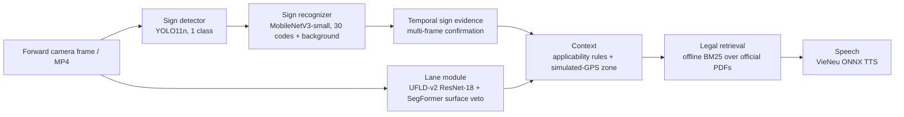
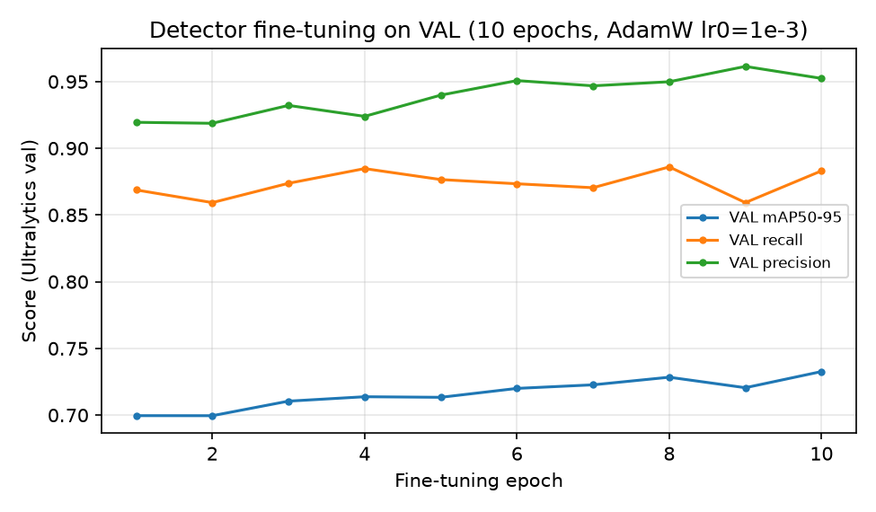
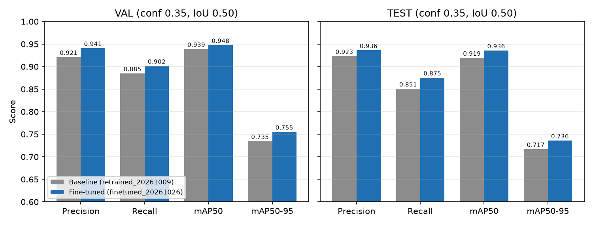
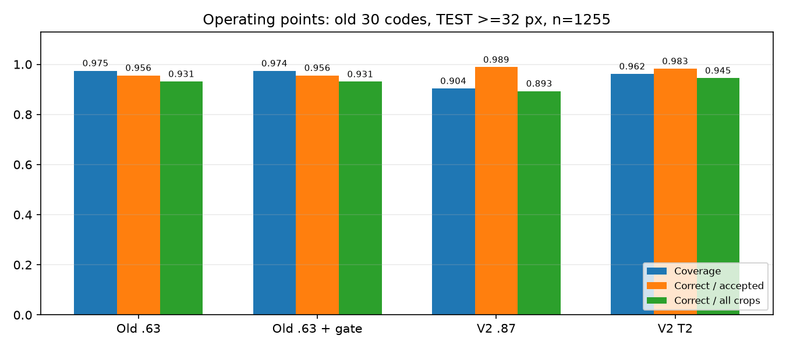
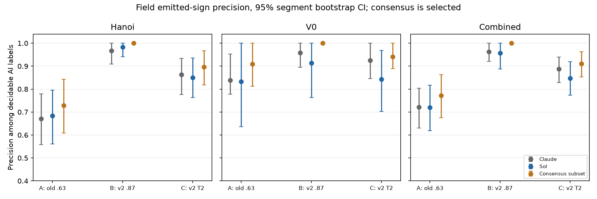
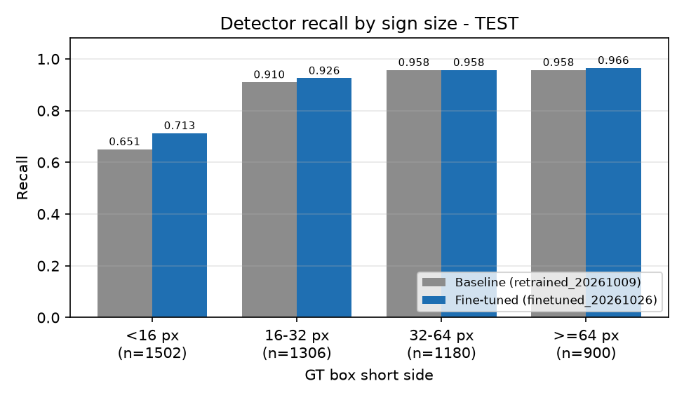
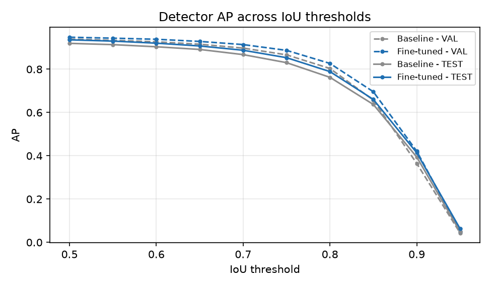
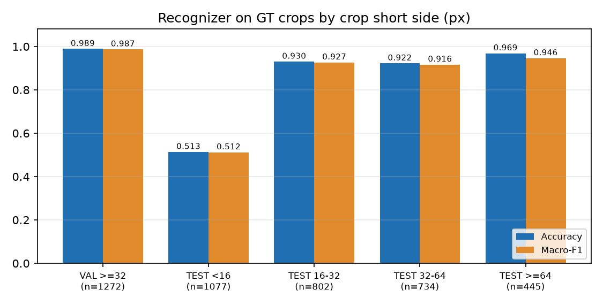
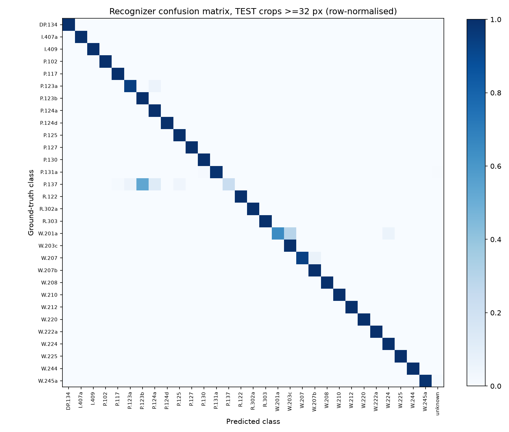
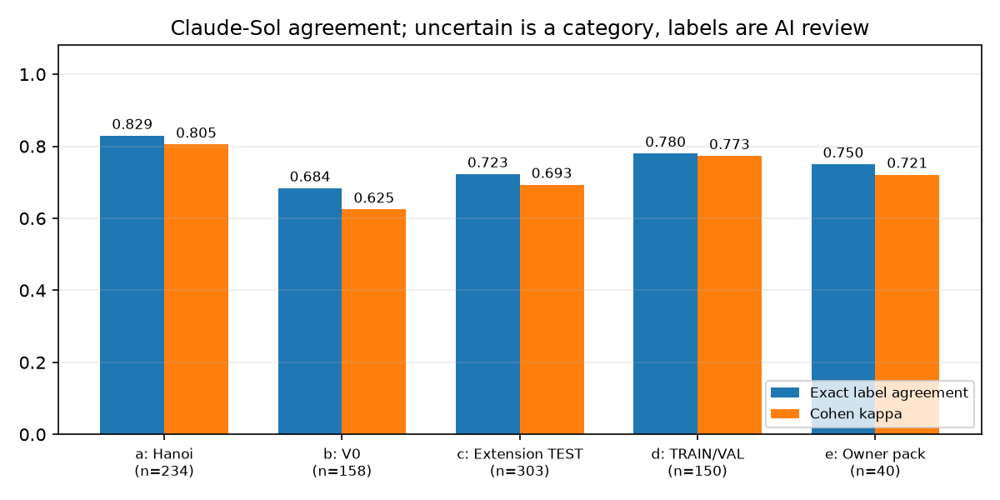

# ITAS-MM - Report 3: Model and Results (Sections IV-VII)

DSP391m capstone, week 8 report. Draft prepared 2026-10-26 on branch `work/kiet-dataset-v2` from the revalidation run documented in [`docs/KIET_REVALIDATION_20261026.md`](../KIET_REVALIDATION_20261026.md). Figures are produced by `scripts/make_report3_figures.py` from local evaluation artifacts.

Scope note: ITAS-MM is a research prototype that processes offline MP4 video. It is not a certified or field-validated driver-assistance system. All numbers below come from the stated datasets and protocols; none is a road-safety claim.

## IV. Model Development

### IV.1 System overview

Perception is split into two stages: a single-class detector localises every traffic-sign panel, and a separate classifier assigns the QCVN sign code. This keeps localisation independent of the class vocabulary and lets the recognizer reject uncertain crops through a background class and a reference gate.

### IV.2 Model architecture

| Component | Architecture | Size | Input / output | Runtime file |
|---|---|---|---|---|
| Sign detector | Ultralytics YOLO11n | 2.59 M parameters | 640 px image (960 px multi-scale on video), 1 class `traffic_sign` | `models/sign_detector/retrained_20261009.pt` (shared default) |
| Sign recognizer | torchvision MobileNetV3-small | 1.56 M parameters | 128 px crop, 31 outputs (30 QCVN codes + background), confidence 0.63, reference-gate margin 0.015 | `models/sign_recognizer/retrained_20261009.pt` |
| Lane | UFLD-v2, ResNet-18 backbone (row-anchor classification) with SegFormer road-surface veto | CULane-trained weights | ego-lane polylines | `models/lane/selected_20261009.pth` |
| Context | Rule-based applicability (vehicle class, supplementary panels) and zone classifier on simulated GPS | - | zone label, applicable rules | `src/context/` |
| Legal retrieval | BM25 with positional bigram/trigram evidence, no generation | 703 page-grounded chunks from 4 official PDFs | ranked legal locators | `src/reasoning/offline_legal_retrieval.py` |
| Speech | VieNeu v3 ONNX (offline) | - | Vietnamese MP3, cached by text | `src/interaction/` |

The lane, context, retrieval and speech modules are integrated in the pipeline but only the detector, recognizer and retrieval have quantitative evaluation in this report (see VII.3).

### IV.3 Data used for training and evaluation

- Source: five public Vietnamese traffic-sign datasets (four Kaggle sets and Roboflow v6), merged with provenance tracking, exact-duplicate removal and lineage grouping.
- Canonical localisation set: 15,603 images and 30,558 boxes. Split by lineage group to prevent near-duplicate leakage: TRAIN 10,952 images / 20,923 boxes, VAL 2,325 / 4,747, TEST 2,326 / 4,888.
- Recognition manifest V1.1: 10,003 crops over 30 released sign codes (TRAIN 5,673, VAL 1,272, TEST 3,058). TRAIN and VAL contain only crops with short side >= 32 px; TEST keeps all sizes for evaluation.
- Sign-code labels were produced by an AI-assisted semantic audit, not by independent human annotators. Detector boxes are the canonical boxes of the source datasets.

### IV.4 Training procedure

Detector (three successive stages, same YOLO11n model):

| Stage | Initialisation | Epochs | Optimiser / lr0 | Augmentation | Selection |
|---|---|---:|---|---|---|
| 1. Baseline | `yolo11n.pt` pretrained weights | 20 | auto / 0.01 | none (mosaic, flips, HSV off) | best VAL fitness |
| 2. `retrained_20261009` | stage 1 | 8 | AdamW / 1e-4 | light HSV and scale | best VAL fitness |
| 3. `finetuned_20261026` (this report) | stage 2 | 10 | AdamW / 1e-3, final lr factor 0.01 | HSV 0.005/0.15/0.15, rotation 2 deg, translate 0.03, scale 0.15; mosaic and flips off | max VAL mAP50-95 |

Stage 3 ran on an RTX 3050 Laptop GPU (4 GB) with batch 16, 640 px, AMP and seed 391; it completed 10/10 epochs in 23 min 10 s without out-of-memory errors. Horizontal flips stay disabled: mirroring would turn left-turn and right-turn signs into each other.

Recognizer: MobileNetV3-small trained on TRAIN sign crops plus background crops, thresholds calibrated on VAL. It was not retrained in this report.

*Figure 4. VAL metrics per fine-tuning epoch (Ultralytics validator). The best epoch is the last one, so the model may not have converged.*

### IV.5 Final evidence update: recognizer v2 and unchanged detector (2026-10-29)

This addition records task artifacts named `20261030`, executed on 2026-10-29. Earlier subsections and figures retain the historical 2026-10-26 snapshot. The active recognizer now has 87 sign codes plus background (88 outputs), with MobileNetV3-small initialised from the earlier 30-code checkpoint. Crops enter training at a native short side of 16 px, resized to 128 px. The extension is AI-reviewed (`ai_reviewed`); it is not human ground truth. The default detector remains `finetuned_20261026.pt`, whose three training stages and VAL-only selection are documented in IV.4. This task does not train or replace the detector.

Recognizer training uses 30 epochs, seed 20261028, batch 128, 14000 sampled crops per epoch, learning rate 0.0004, balance power 0.7, AdamW and OneCycleLR. There are 17445 TRAIN crops and 3933 VAL crops. Selection uses VAL main-class macro-F1 and VAL threshold calibration; TEST is reporting only. The current checkpoint threshold is 0.87 with no reference gate. T2 (0.641290187406794) is a VAL-only alternative and is not promoted.

The exact committed training script was checked against evidence HEAD `15cdef5a33b0b11c1c3cc8af0c6157e225a319f5`. Its SHA256 is `0a19d0b0d9e3bfaed3d5005d6b81140e5705f075a325e6a419c1a68db0e9a42f`. The original script, evaluator, default models, perception config and local dataset config retained their pinned hashes through the reproduction. The machine uses Python 3.12, PyTorch 2.11.0+cu128 and an RTX 3050 Laptop GPU with 4 GB VRAM. Reproduction outputs are isolated under `output/kiet_wp_20261030/repro/`.

## V. Model Evaluation and Fine-Tuning

### V.1 Evaluation metrics

| Module | Metrics | Protocol |
|---|---|---|
| Detector | Precision, recall, mAP50, mAP50-95; recall by GT box short side | Confidence 0.35, NMS IoU 0.45, match IoU 0.50, 101-point AP, one class |
| Recognizer | Accuracy, macro-F1 over classes with support, confusion matrix | GT-box crops, raw argmax, grouped by crop short side |
| Field pilot | Precision, recall | 120 owner-reviewed video frames, same detector protocol |
| Legal retrieval | Recall@1/3/4, MRR | 24-case development regression suite |
| Runtime | ms per image, FPS | 50 VAL images, CUDA, warm-up excluded, audio off |

### V.2 Hyperparameter tuning

Tuning was limited to one fine-tuning configuration (stage 3 above), chosen to adapt the stage-2 model with a higher learning rate and mild photometric and geometric augmentation. Candidate selection used only VAL mAP50-95; the selected checkpoint was then evaluated once on TEST. No threshold, weight or data choice was changed after seeing TEST. A wider search (learning rate, image size, SAHI tiling) was not run because of the 4 GB GPU budget and schedule.

### V.3 Validation strategy

K-fold cross-validation was not used: each detector fold would cost about 25 minutes on the available GPU, and random folds would break the lineage grouping that prevents leakage between near-duplicate frames. Instead the project uses:

1. a fixed lineage-grouped TRAIN/VAL/TEST split, with TEST reserved for final reporting;
2. a paired image-level bootstrap on TEST (1,000 resamples, seed 20261026) to quantify uncertainty of the model difference;
3. a separate field pilot: 120 frames from a development driving video, reviewed by the project owner.

### V.4 Fine-tuning result

| Split | Model | Precision | Recall | mAP50 | mAP50-95 |
|---|---|---:|---:|---:|---:|
| VAL | Baseline | 0.9211 | 0.8850 | 0.9390 | 0.7347 |
| VAL | Fine-tuned | 0.9409 | 0.9016 | 0.9477 | 0.7553 |
| TEST | Baseline | 0.9232 | 0.8509 | 0.9194 | 0.7168 |
| TEST | Fine-tuned | 0.9361 | 0.8754 | 0.9357 | 0.7360 |

Paired bootstrap on TEST, fine-tuned minus baseline: recall +0.0245, 95% CI [0.0170, 0.0317]; mAP50 +0.0163, 95% CI [0.0122, 0.0198]. Both intervals exclude zero.

*Figure 1. Detector metrics before and after fine-tuning.*

### V.5 Recognizer TEST by native crop size and operating point

Raw argmax evaluation on the original 30 codes uses the same frozen TEST crops for both checkpoints. These numbers use existing AI-assisted dataset labels and do not measure detector recall or field accuracy. Half-open groups are [16,32), [32,64) and [64,infinity); >=32 is an overlapping aggregate.

| Short side (px) | n | Old accuracy | V2 accuracy | Old macro-F1 | V2 macro-F1 |
| --- | --- | --- | --- | --- | --- |
| <16 | 1078 | 0.5139 | 0.7839 | 0.5151 | 0.7912 |
| 16-32 | 811 | 0.9309 | 0.9815 | 0.9266 | 0.9874 |
| 32-64 | 753 | 0.9150 | 0.9628 | 0.9002 | 0.9562 |
| >=64 | 502 | 0.9701 | 0.9801 | 0.9057 | 0.9499 |
| >=32 | 1255 | 0.9371 | 0.9697 | 0.9056 | 0.9594 |
| all | 3144 | 0.7904 | 0.9090 | 0.8194 | 0.9274 |

New main classes have 25 declared codes; only 21 have TEST support in the full original evaluation.

| Size | n | V2 accuracy | Macro-F1 |
| --- | --- | --- | --- |
| <16 | 2 | 1.0000 | 1.0000 |
| 16-32 | 106 | 0.8585 | 0.8570 |
| 32-64 | 208 | 0.8510 | 0.8654 |
| >=64 | 194 | 0.7680 | 0.7927 |
| >=32 | 402 | 0.8109 | 0.8534 |
| all | 510 | 0.8216 | 0.8736 |

Operating metrics distinguish coverage (accepted/all), accepted accuracy (correct/accepted), and end-to-end crop correctness (correct/all). The following table uses old 30 codes, TEST >=32 px; the old gate verdicts are existing pinned inputs, not a gate rebuilt in this task. Raw argmax accuracy above has a different numerator from thresholded correctness below.

| Setting | n | Accepted | Correct | Coverage | Correct / accepted | Correct / all |
| --- | --- | --- | --- | --- | --- | --- |
| old_063_no_gate | 1255 | 1223 | 1169 | 0.9745 | 0.9558 | 0.9315 |
| old_063_gate | 1255 | 1222 | 1168 | 0.9737 | 0.9558 | 0.9307 |
| new_087_no_gate | 1255 | 1134 | 1121 | 0.9036 | 0.9885 | 0.8932 |
| new_t2_no_gate | 1255 | 1207 | 1186 | 0.9618 | 0.9826 | 0.9450 |

### V.6 Training reproduction

| Measure | Original | Reproduction | Difference |
| --- | --- | --- | --- |
| Selected epoch | 18 | 18 | 0 |
| VAL main macro-F1 | 0.9511 | 0.9500 | -0.0011 |
| Calibrated threshold | 0.87 | 0.87 | 0.0 |

| Old-30 TEST group | n | Original accuracy | Reproduced accuracy | Difference |
| --- | --- | --- | --- | --- |
| <16 | 1078 | 0.7839 | 0.7792 | -0.0046 |
| 16-32 | 811 | 0.9815 | 0.9778 | -0.0037 |
| 32-64 | 753 | 0.9628 | 0.9628 | 0.0000 |
| >=64 | 502 | 0.9801 | 0.9801 | 0.0000 |
| >=32 | 1255 | 0.9697 | 0.9697 | 0.0000 |
| all | 3144 | 0.9090 | 0.9065 | -0.0025 |

Reproduced within the registered tolerance of 0.01: both VAL main macro-F1 and TEST >=32 px accuracy differ by at most this amount. Both select epoch 18 and threshold 0.87. Training took 484.3 s. This demonstrates a local same-machine reproduction, not bitwise identity or an independent-machine restore. cuDNN nondeterminism is a possible explanation for the small differences; it was not experimentally isolated.

### V.7 Field A/B/C precision under two AI reviewers

A is the old recognizer at 0.63 with its old gate; B is v2 at 0.87 without a gate; C is v2 at VAL-selected T2 without a gate. The unit is an emitted confirmed (track, label) item, not an annotated physical sign event. Precision is correct/(correct + wrong_code + not_a_sign); uncertain items remain counted but are excluded from the precision denominator. Each cell reports precision [95% CI]; the following denominator is correct/decidable. The consensus mode retains only Claude = Sol, including matching uncertain labels before denominator filtering.

Intervals use 2,000 bootstrap draws of whole video/60-second segment clusters with seed 20261030. V0 has only five clusters, and neighboring Hanoi segments may remain correlated. No crop-level or per-frame independence is assumed. New CIs use this seed; original Claude verdict counts were checked exactly against `summary_all.json`.

| Population | Labels | A | B | C |
| --- | --- | --- | --- | --- |
| hanoi | claude | 0.6706 [0.5584, 0.7791]; 57/85 | 0.9672 [0.9091, 1.0000]; 59/61 | 0.8625 [0.7763, 0.9342]; 69/80 |
| hanoi | sol | 0.6842 [0.5606, 0.7952]; 52/76 | 0.9825 [0.9412, 1.0000]; 56/57 | 0.8493 [0.7639, 0.9351]; 62/73 |
| hanoi | consensus | 0.7286 [0.6087, 0.8421]; 51/70 | 1.0000 [1.0000, 1.0000]; 55/55 | 0.8955 [0.8182, 0.9667]; 60/67 |
| v0 | claude | 0.8378 [0.7778, 0.9524]; 31/37 | 0.9583 [0.8947, 1.0000]; 46/48 | 0.9245 [0.8462, 1.0000]; 49/53 |
| v0 | sol | 0.8333 [0.6364, 1.0000]; 20/24 | 0.9143 [0.7632, 1.0000]; 32/35 | 0.8421 [0.7021, 0.9688]; 32/38 |
| v0 | consensus | 0.9091 [0.8125, 1.0000]; 20/22 | 1.0000 [1.0000, 1.0000]; 32/32 | 0.9412 [0.8889, 1.0000]; 32/34 |
| combined | claude | 0.7213 [0.6306, 0.8037]; 88/122 | 0.9633 [0.9208, 1.0000]; 105/109 | 0.8872 [0.8286, 0.9389]; 118/133 |
| combined | sol | 0.7200 [0.6186, 0.8161]; 72/100 | 0.9565 [0.8878, 1.0000]; 88/92 | 0.8468 [0.7739, 0.9192]; 94/111 |
| combined | consensus | 0.7717 [0.6753, 0.8636]; 71/92 | 1.0000 [1.0000, 1.0000]; 87/87 | 0.9109 [0.8529, 0.9625]; 92/101 |

Matching reviewers are a selected easier subset, so the consensus precision of 1.0 for B and its degenerate [1,1] empirical interval are not proof of error-free performance. Sol labels more crops uncertain than Claude, which changes denominators. Cross-review comparisons are descriptive and cannot replace adjudicated human GT. V0 is an existing development-video TEST group, not a newly independent external holdout.

The existing proxy-recall annotations were not independently relabeled in this task. Proxy recall is conditional on detector proposals and is not physical sign-event recall:

| Config | Annotated proposals | Caught | Proxy recall |
| --- | --- | --- | --- |
| A | 46 | 29 | 0.6304 |
| B | 46 | 34 | 0.7391 |
| C | 46 | 35 | 0.7609 |

The registered T2 rule requires C precision within 0.02 of B, C errors no higher than A, and C proxy recall above B. Reusing the existing AI proxy recall, all three label modes fail the precision condition:

| Labels | B precision | C precision | Precision within 0.02 | Errors <= A | Proxy recall > B | Decision |
| --- | --- | --- | --- | --- | --- | --- |
| claude | 0.9633 | 0.8872 | False | True | True | not_recommended |
| sol | 0.9565 | 0.8468 | False | True | True | not_recommended |
| consensus | 1.0000 | 0.9109 | False | True | True | not_recommended |

Keep 0.87. No TEST-based threshold adjustment is made. Gate v2 also has no observed field benefit: on Hanoi, fresh comparison of emitted evidence keys and predictions finds D exactly equal to C and E exactly equal to B. These are the tested configurations only; this does not prove all possible gates ineffective.

| Gate config | Base | Emitted items | Identical evidence and predictions |
| --- | --- | --- | --- |
| D | C | 100 | True |
| E | B | 75 | True |

### V.8 Optional missing-label work and lane proxy

P4 was not run: optional detector missing-label adjudication and unmatched-TEST detection sampling were deferred to preserve time for mandatory reporting, verification and PR delivery. No consensus missing-label manifest, adjusted detector precision, Wilson interval or detector retraining is claimed. Existing canonical annotations remain unchanged.

P5 samples 60 equally spaced midpoint frames across the three Hanoi EVAL videos: 15 from each of two day videos and 30 from the night video, excluding V0. It calls the pipeline default `LaneDetector(load_config('perception')).detect` with `lane_visual_roi=False`, using UFLD-v2. Optional camera-aware display fallback and temporal smoothing are not applied. All 60 overlays were opened individually and assigned an observation. Qualitative AI ratings are:

| Lighting | n | good | partial | fail | no_visible_lane | Visible-only fail fraction |
| --- | --- | --- | --- | --- | --- | --- |
| day | 30 | 0 | 3 | 15 | 12 | 0.8333 |
| night | 30 | 0 | 9 | 15 | 6 | 0.6250 |
| all | 60 | 0 | 12 | 30 | 18 | 0.7143 |

Among all day frames, the fractions good/partial/fail/no_visible_lane are 0.0000/0.1000/0.5000/0.4000; at night they are 0.0000/0.3000/0.5000/0.2000. The visible-only denominator excludes no_visible_lane. Paint often vanishes at intersections or is hidden by vehicles. Failures include missing visible markings, jagged interior curves and rectangular outliers. This is AI qualitative review, not lane F1, and cannot establish that night is better than day on three videos. Vietnamese human lane GT is still absent.

An exploratory lane-GT check was also run on 30 of these frames (15 day, 15 night; seed 20261030). The GT was drawn blind to the detector output by one AI model (Claude Haiku 5.5 in Claude Code; `human_gt=false`; GT file SHA256 `ac3c1523227194fd81b2aad0e2de952ea6159707a261cc26e4c5a56f23fe9090`, local output only). Under the protocol fixed beforehand (30 px polyline masks, IoU > 0.5, optimal matching) it gives TP 1, FP 37, FN 23 and F1 0.032 (day 0.000, night 0.038); the most lenient sensitivity setting (50 px, IoU 0.3) gives 0.258. **This is not reported as a lane result.** The GT comes from a single model, its pixel accuracy is unverified, it covers only the visible segments while the detector draws full-length curves, and in several frames it follows curbs, barriers or medians instead of painted markings, so it does not match the intended definition. A visual check of 20 of the 30 frames shows both effects: detector curves that follow the same edge as the GT yet fail the IoU test, and genuine failures (jagged curves crossing vehicles; no output on 5 of the 14 frames that have GT). The qualitative table above remains the only lane evidence.

## VI. Results Interpretation and Visualization

### VI.1 Small signs are the main detector weakness

*Figure 2. TEST recall by GT box short side.*

Signs below 16 px make up 1,502 of 4,888 TEST boxes (31%). Their recall is 0.651 for the baseline and 0.713 after fine-tuning, while signs of 32 px or more reach about 0.96. Fine-tuning helped most where the model was weakest, but distant signs remain the largest source of misses, which matches the small-object problem identified in the proposal.

### VI.2 Localisation is good at IoU 0.5 but loose at strict IoU

*Figure 3. AP across IoU thresholds.*

For the fine-tuned model, TEST AP stays above 0.85 up to IoU 0.75 and falls sharply after 0.85 (TEST fine-tuned: 0.660 at 0.85, 0.414 at 0.90, 0.063 at 0.95). Boxes are good enough to crop a sign for recognition, but not pixel-tight; this explains why mAP50-95 (0.736) is much lower than mAP50 (0.936).

### VI.3 Recognizer accuracy depends on crop size

*Figure 5. Recognizer accuracy and macro-F1 by crop short side.*

On TEST crops of 32 px or more the recognizer reaches accuracy 0.940 and macro-F1 0.918, close to VAL (0.989). Below 16 px accuracy drops to 0.513. TRAIN and VAL contain no crops below 32 px, so this is an untrained size range rather than overfitting. The runtime pipeline applies a minimum crop size (32 px on images, 12 px on video) and multi-frame confirmation; the 12 px video setting still falls inside the weak size range.

*Figure 6. Row-normalised confusion matrix, TEST crops >= 32 px.*

Errors are concentrated in visually similar prohibitions and warnings: P.137 (no left and right turn) is predicted correctly in 17 of 73 crops and confused with P.123b (no right turn) in 39; W.201a (dangerous curve) is confused with W.203c (road narrows) in 5 of 17.

### VI.4 Field pilot shows a domain gap

| Model | Frames | GT signs | TP | FP | FN | Precision | Recall |
|---|---:|---:|---:|---:|---:|---:|---:|
| Baseline | 120 | 66 | 50 | 28 | 16 | 0.641 | 0.758 |
| Fine-tuned | 120 | 66 | 51 | 19 | 15 | 0.729 | 0.773 |

On real driving frames precision is about 0.2 lower than on the dataset TEST split. Fine-tuning reduced false alarms from 28 to 19 while keeping recall. The pilot is small (66 signs, one video), its boxes come from the owner's bulk approval of detector proposals (with the owner's statement that no visible sign was missed), and sign codes and lanes were not reviewed. It indicates a domain gap but is not an independent test set.

### VI.5 Runtime and legal retrieval

| Item | Result |
|---|---|
| Detector, fine-tuned | 10.8 ms/image (92.7 FPS) |
| Recognizer | 0.12 ms/crop (batch 50) |
| Offline pipeline per image (detection, recognition, lane, context, retrieval; audio off) | 46.2 ms (21.7 FPS) |
| Legal retrieval, 24 development cases | Recall@1 0.542, Recall@3 0.833, Recall@4 0.875, MRR 0.684 |

Measured on an RTX 3050 Laptop GPU. Per-image pipeline latency is not the latency of the full video application. The retrieval suite is a development regression set; legal currency of the corpus is not verified.

### VI.6 Blind second review and label reliability

The new pack contains 885 individually opened crops, shuffled and renumbered with seed 20261030. Public items expose only number and original short side. Claude labels, model predictions and the private mapping were withheld from the reviewer until labels were completed and sealed. Each crop has its own visual description; crops below native 16 px cannot receive a readable code. The sealed blind-label SHA256 is `e7c88c012890fef7cc43aad1b1e8645242769c4ca3fb8741f814a42615c0ba47`. The released manifest retains original source keys, both AI labels and provenance; Claude labels were not edited.

Sources are a: all Hanoi pack evidence; b: V0 evidence; c: all agreed extension TEST boxes with 15% crop margin; d: stratified TRAIN/VAL agreed boxes with at most ten per code; e: owner spot-check original crops with four attention checks excluded. Source e deliberately overlaps some a crops; cross-source totals are not 885 independent physical signs. Exact pixel duplicates were consistency-checked before sealing, with an ambiguous duplicate revised to uncertain. Raw exact agreement and Cohen kappa treat uncertain and not_a_sign as categories:

| Source | n | Exact agreement | Kappa | Claude uncertain | Sol uncertain |
| --- | --- | --- | --- | --- | --- |
| a | 234 | 0.8291 | 0.8051 | 49 | 67 |
| b | 158 | 0.6835 | 0.6246 | 20 | 61 |
| c | 303 | 0.7228 | 0.6932 | 0 | 58 |
| d | 150 | 0.7800 | 0.7732 | 0 | 28 |
| e | 40 | 0.7500 | 0.7213 | 0 | 7 |

| Source | Size | n | Exact agreement | Kappa |
| --- | --- | --- | --- | --- |
| a | <16 | 8 | 0.5000 | 0.2000 |
| a | 16-32 | 89 | 0.7753 | 0.6682 |
| a | 32-64 | 68 | 0.7941 | 0.7746 |
| a | >=64 | 69 | 0.9710 | 0.9659 |
| b | <16 | 3 | 1.0000 | - |
| b | 16-32 | 56 | 0.5179 | 0.3695 |
| b | 32-64 | 63 | 0.6349 | 0.5671 |
| b | >=64 | 36 | 1.0000 | 1.0000 |
| c | <16 | 13 | 0.0000 | 0.0000 |
| c | 16-32 | 66 | 0.4697 | 0.4291 |
| c | 32-64 | 92 | 0.8043 | 0.7771 |
| c | >=64 | 132 | 0.8636 | 0.8377 |
| d | <16 | 4 | 0.0000 | 0.0000 |
| d | 16-32 | 47 | 0.5106 | 0.4934 |
| d | 32-64 | 54 | 0.8889 | 0.8833 |
| d | >=64 | 45 | 1.0000 | 1.0000 |
| e | <16 | 1 | 1.0000 | - |
| e | 16-32 | 8 | 0.7500 | 0.6522 |
| e | 32-64 | 18 | 0.6111 | 0.5625 |
| e | >=64 | 13 | 0.9231 | 0.9116 |

Largest disagreement pairs are descriptive and do not determine which reviewer is right. All pairs and both-decidable statistics are in the release-gate evidence, with every individual disagreement recoverable from the committed manifest. The local owner-review table is `output/kiet_wp_20261030/second_review/disagreements.csv`.

| Source | Claude | Sol | n |
| --- | --- | --- | --- |
| a | I.423 | uncertain | 8 |
| a | P.130 | uncertain | 6 |
| a | uncertain | P.124a | 4 |
| a | P.131a | uncertain | 4 |
| b | P.131a | uncertain | 27 |
| b | P.130 | uncertain | 12 |
| b | W.225 | W.203a | 9 |
| b | W.225 | uncertain | 2 |
| c | R.301c | uncertain | 22 |
| c | W.203a | W.203b | 21 |
| c | P.105 | uncertain | 14 |
| c | R.412 | uncertain | 7 |
| d | I.442 | uncertain | 7 |
| d | W.246a | uncertain | 7 |
| d | R.412 | uncertain | 5 |
| d | P.131a | uncertain | 3 |
| e | not_a_sign | uncertain | 3 |
| e | not_a_sign | P.127 | 2 |
| e | P.130 | uncertain | 2 |
| e | other_qcvn | P.107b | 1 |

Owner spot-check covers 40 crops, with 3 owner unsure answers and 7 Sol uncertain labels. On 32 jointly decidable assertions, Sol agrees with the owner's accept/reject of the displayed label at 0.9062 (29/32). Owner answers are ok/not_ok/unsure, not corrected QCVN codes; this is not exact-code accuracy or expert human GT.

P.127 speed rings inside composite lane/speed boards follow the probe convention and must not be confused with whole-board or direction labels such as R.415a. Vehicle badges and circular decorations can resemble speed rings: there are field disagreements where Claude says not_a_sign and Sol says P.127. These are candidate label errors by either reviewer, not confirmed corrections. Human adjudication is needed before changing TEST labels. Likewise W.203a/W.203b perspective, P.131a versus uncertain, and R.301c versus uncertain dominate some packs. Dataset missing signs can make a real detector discovery appear to be an FP; P4 has not quantified that effect here.

For the 25 declared new main classes, filtering source c to Claude = Sol yields the following model accuracy:

| Size | n | Correct | Accuracy | Represented classes |
| --- | --- | --- | --- | --- |
| <16 | 0 | 0 | - | 0 |
| 16-32 | 11 | 11 | 1.0000 | 3 |
| 32-64 | 36 | 36 | 1.0000 | 4 |
| >=64 | 63 | 63 | 1.0000 | 5 |
| >=32 | 99 | 99 | 1.0000 | 5 |
| all | 110 | 110 | 1.0000 | 5 |

The all-size consensus subset has 110/110 correct but covers only five classes. It excludes uncertain and disputed examples and is not a validated 25-class result. The original full-data evaluation in V.5 is retained alongside this selected subset. Neither AI consensus nor reviewer calibration supplies independent human GT. P1 guided calibration results are at `D:/DSP391m/model_probe_20261029_r2/results/gpt-6.1-sol_guided/`; Codex did not open answer keys or other models' results and did not self-grade that calibration.

## VII. Conclusion and Recommendations

### VII.1 Key findings

1. A short fine-tuning stage improved the detector on every TEST metric; the gains in recall (+2.5 points) and mAP50 (+1.6 points) are statistically supported by the bootstrap.
2. Small and distant signs remain the main weakness of both detection (recall 0.71 below 16 px) and recognition (accuracy 0.51 below 16 px).
3. The recognizer is reliable on crops of 32 px or more (accuracy 0.94 on TEST); remaining errors are between visually similar codes.
4. Performance on real driving video is clearly lower than on the curated dataset, so dataset metrics overstate field performance.
5. The perception and retrieval path runs at about 22 frames per second on a 4 GB laptop GPU, which is sufficient for offline video analysis.

### VII.2 Recommendations

1. Adopt `finetuned_20261026.pt` as the shared detector after group review, together with the config, test and Git LFS updates listed in the revalidation report.
2. Target small signs directly: evaluate the existing SAHI tiling path and add small crops (16-32 px) to recognizer training, tuned on VAL only.
3. Add training examples or a dedicated rule for the P.137 / P.123b pair and for W.201a / W.203c.
4. Build an independent, source-disjoint field test set with human-reviewed boxes, sign codes and lane annotations; this is required before reporting field accuracy or lane quality.
5. Add OCR for the scanned Decree 168/2024/ND-CP so its articles become retrievable.

### VII.3 Limitations and deviations from the proposal

- Lane quality is not measured: no human-reviewed Vietnamese lane ground truth exists. Only the qualitative 60-frame proxy in V.8 exists; the exploratory AI-drawn GT check described there is not a lane result.
- The end-to-end video demonstration (camera to speech) has not been re-verified on new footage.
- Contrastive-learning feature separation proposed for small signs was not implemented; SAHI exists but is disabled and unevaluated.
- Road-zone context uses simulated GPS only.
- The proposal cites QCVN 41:2019; the corpus uses QCVN 41:2024.
- Sign-code labels are AI-assisted, and the TEST split was used in earlier project phases, so it is not a pristine holdout.

### VII.4 Reflection on the process

The largest practical problem was reproducibility: model weights and evaluation artifacts lived only on individual machines, and a rebuild lost historical reports. Moving weights to Git LFS, pinning dataset and model SHA256 values, and recording commands for every metric made the results in this report reproducible on a second machine. Future work should keep raw data and human review decisions in a backed-up, versioned store with a tested restore procedure.

### VII.5 Issue #2 acceptance status and release decision

The following status is checked against [issue #2](https://github.com/BANGPC123/itas-mm-scaffold/issues/2) and the current local artifacts. It separates local technical evidence from human annotation, legal ownership, off-machine recovery and approval. Earlier historical wording about second-machine reproducibility is not current proof of an executed independent restore.

| Work package | Status | Evidence and remaining closure condition |
| --- | --- | --- |
| WP1 - lawful dataset v2 and reproducible provenance | PARTIAL | Versioned manifests and source-disjoint protocol exist; pinned same-machine train reproduction passes. Dataset rights, clean-clone acquisition and independent-machine rebuild still need owner evidence. |
| WP2 - human field boxes, sign codes, context and lane GT | BLOCKED | Claude/Sol labels and owner spot-check are recorded with distinct provenance. Required human adjudication and Vietnamese lane/context GT are absent. |
| WP3 - fresh benchmark on verified GT | PARTIAL | Frozen TEST, operating points, two-reviewer field precision and lane proxy are reported. Human event recall, lane F1 and end-to-end safety performance remain unverified. |
| WP4 - legacy-test triage, v2 acceptance and video release gate | PARTIAL | Legacy cases are explicitly archived and v2 tests have local evidence; final local checks are recorded below. No new full application MP4/audio/seek QA or release approval is claimed. |
| Backup - permissioned, versioned storage and restore | UNVERIFIED | No independent-machine restore, backup encryption/access audit or off-machine recovery was executed in this task. Owner must provide and test the backup/restore procedure. |

Met locally: isolated reproduction within tolerance, sealed second AI review, provenance-preserving manifests, no TEST tuning, JSON-derived tables/figures and unchanged default model hashes. The final automated-check snapshot is recorded in VII.6 and `release_gate_v2.json`.

Not met: human-reviewed event and lane GT, expert adjudication of disputed labels, dataset-rights acceptance, clean-clone/second-machine restore, independent field safety validation, owner release approval and new full-app perceptual acceptance. The prototype remains offline research software, not a safety system. Release decision remains **HOLD**, approval remains **NOT_APPROVED**, and lowering the recognizer threshold or enabling gate v2 is not recommended by these measurements.

Priority next steps: owner assigns expert adjudication to the disagreement manifest, builds source-disjoint human field boxes/codes/events and lane/context GT, then reruns the frozen benchmark. Separately verify dataset rights and a permissioned off-machine restore. Only after those closure conditions and owner review should model promotion or a release decision be reconsidered. Optional missing-label estimation can proceed as a separate report-only task with blind review; canonical annotations must not be silently repaired using this TEST review.

### VII.6 Final local verification snapshot

| Check | Result | Scope |
|---|---|---|
| Baseline pytest | 568 passed, 11 skipped, 38 deselected | Native Windows, before changes |
| Final pytest | 574 passed, 11 skipped, 38 deselected; exit 0 | Includes six new tests for blind-pack projection, sampler, Cohen kappa, clustered precision, SHA seal and frame sampling |
| acceptance_v2 | 11 passed; exit 0 | Dataset opt-in enabled; existing local artifacts and hashes checked |
| Frontend Node | 7/7 passed; exit 0 | Existing frontend behavior tests |
| Frontend build | PASS; exit 0 | Vite production build |

The 11 default skipped cases are separately exercised by the opt-in acceptance run; 38 legacy cases remain explicitly deselected by repository configuration. Windows sandbox temp-directory ACL and child-process EPERM errors were resolved by running the same checks natively with a separate temp root; they did not require source changes. Logs and JUnit XML are under `output/kiet_wp_20261030/verification/`. Default detector, recognizer, dataset config and other reproduction pins were rehashed and remain unchanged. Hosted CI is recorded on the PR after push and is separate from these dataset/GPU-local checks. No new full GUI, playback/listening or independent-machine restore acceptance was performed.

## Reproducibility

- Code: branch `work/kiet-dataset-v2`, PR #3 to `integration/itas-mm-release-candidate-20261021`.
- Model SHA256: baseline `4fe92aaf...ee22073`, fine-tuned `c7fc0b60...149541f`, recognizer `c1dad57d...babb859b`.
- Environment: Python 3.12.15, PyTorch 2.11.0+cu128, Ultralytics 8.4.189, Windows 11, RTX 3050 Laptop GPU 4 GB.
- Metric sources and their SHA256 fingerprints: [`docs/KIET_REVALIDATION_20261026.md`](../KIET_REVALIDATION_20261026.md). Evaluation artifacts under `output/` are local and not in Git.
- Figures: `python scripts/make_report3_figures.py` (requires those local artifacts).

Final-evidence sources (local ignored artifacts; hashes do not imply remote availability):

| JSON source | SHA256 |
| --- | --- |
| output/kiet_wp_20261030/repro/provenance.json | `adbf0732bbed6d98b7d7e26cfd0ad91d93f14820ddd10a4c9e62b6579ad68947` |
| output/kiet_wp_20261030/repro/comparison.json | `7e3adc3a2d5da7cd570758ae67c2247cb80f13aca30053249e87661258ddaae4` |
| output/kiet_wp_20261030/second_review/results.json | `0400e41415b84e082804aa286a1c3ec6168230f89306722498e1ce091cf1b56a` |
| output/kiet_wp_20261030/operating_points.json | `b07c985436b74e35e9bd3c1e7ca12f567c138e787260939f3a4e852a7d6e3ce1` |
| output/kiet_wp_20261030/lane_proxy/results.json | `8590c49ade13450a57786f2250ed7c3e38b936d1d9b538d6925b5a667731508e` |
| output/kiet_wp_20261028/recognizer_v2/eval/results.json | `4b50b5ecf8d896d4d142d1ca0639158d5b774ba9cf76f641c7854162dce18bb3` |
| output/kiet_wp_20261029/summary_all.json | `678bca26f05223b287c1e21cfb32d7a214df439cb85ba13b48371c78a7979264` |

Regenerate the three new figures only with `python scripts/make_report3_figures.py --final-evidence`. The original six figures are retained. Full raw local outputs, crops, dataset, videos and models are intentionally excluded from this PR; a fresh clone alone cannot reproduce these figures without acquiring the pinned inputs.
